# TÀI LIỆU ĐẶC TẢ TÍNH NĂNG VÀ THỰC THỂ CƠ SỞ DỮ LIỆU (DATABASE SPECIFICATION)
> **Dự án:** Student Coin Portal (Cổng thông tin đổi thưởng & học tập tích lũy xu)  
> **Phiên bản tài liệu:** 2.0 (Cập nhật chuẩn hóa 100% theo Quy trình Vận hành Thực tế)  
> **Mục đích:** Cung cấp tài liệu đầy đủ và chi tiết nhất để thiết kế Cơ sở dữ liệu (PostgreSQL / Prisma / MySQL), bao gồm: UI Fields, Business Rules, ERD và bảng ánh xạ trường.

---

## MỤC LỤC
1. [Luồng Tiền Tệ & Quy Đổi Thời Gian Thực (Realtime Coin Economy)](#1-luồng-tiền-tệ--quy-đổi-thời-gian-thực-realtime-coin-economy)
2. [Module 1: Tài Khoản Học Sinh, Đăng Nhập Zalo & Onboarding](#2-module-1-tài-khoản-học-sinh-đăng-nhập-zalo--onboarding)
3. [Module 2: Giáo Viên Tự Cấu Hình Hoạt Động & Quản Lý Xu Độc Lập](#3-module-2-giáo-viên-tự-cấu-hình-hoạt-động--quản-lý-xu-độc-lập)
4. [Module 3: Nộp Bài, AI Chấm Điểm & Quy Trình Duyệt Xu Cuối Ngày](#4-module-3-nộp-bài-ai-chấm-điểm--quy-trình-duyệt-xu-cuối-ngày)
5. [Module 4: Vòng Quay May Mắn (Lucky Wheel) & Cơ Chế Bảo Toàn Xu](#5-module-4-vòng-quay-may-mắn-lucky-wheel--cơ-chế-bảo-toàn-xu)
6. [Module 5: Tổng Kết Cuối Tháng, Thưởng Xếp Hạng & Wall of Fame](#6-module-5-tổng-kết-cuối-tháng-thưởng-xếp-hạng--wall-of-fame)
7. [Module 6: Quy Đổi Xu Cuối Tháng & Xuất Báo Cáo Excel Gửi Email](#7-module-6-quy-đổi-xu-cuối-tháng--xuất-báo-cáo-excel-gửi-email)
8. [Module 7: Quản Lý Ví Xu & Biến Động Số Dư (Coin Ledger)](#8-module-7-quản-lý-ví-xu--biến-động-số-dư-coin-ledger)
9. [Sơ Đồ Thực Thể Quan Hệ Hoàn Chỉnh (ERD)](#9-sơ-đồ-thực-thể-quan-hệ-hoàn-chỉnh-erd)
10. [Bảng Tra Cứu Ánh Xạ UI Fields Sang Database Columns](#10-bảng-tra-cứu-ánh-xạ-ui-fields-sang-database-columns)

---

## 1. Luồng Tiền Tệ & Quy Đổi Thời Gian Thực (Realtime Coin Economy)

### 1.1. Công thức quy đổi thời gian thực
- **Tỷ lệ quy đổi chuẩn:** **Mỗi 5.000 xu = 25.000 VNĐ** (tương đương 1 xu = 5 VNĐ).
- **Quy tắc chặn mốc (Milestone Threshold):** Chỉ khi học sinh tích lũy đủ từng mốc **5.000 xu** mới được quyền rút hoặc đổi quà.
- **Công thức hiển thị thời gian thực:**
  $$\text{Số tiền khả dụng (VNĐ)} = \left\lfloor \frac{\text{current\_coins}}{5.000} \right\rfloor \times 25.000$$
  $$\text{Số xu dư tiếp tục tích lũy} = \text{current\_coins} \pmod{5.000}$$
  *Ví dụ:* Học sinh có **53.600 xu** -> Hệ thống hiển thị:
  - Tổng xu: `53.600 xu`
  - Tiền quy đổi khả dụng: `265.000 VNĐ` (tương ứng 50.000 xu).
  - Xu lẻ tiếp tục nuôi heo: `3.600 xu` (cần thêm 1.400 xu để đạt mốc đổi 25.000 VNĐ tiếp theo).

---

## 2. Module 1: Tài Khoản Học Sinh, Đăng Nhập Zalo & Onboarding

### 2.1. Quy trình học sinh chủ động
- **Tự đăng ký tài khoản:** Học sinh/phụ huynh tự điền thông tin đăng ký:
  - Họ và tên học sinh (ví dụ: "Nguyễn Gia Bảo").
  - Lớp học (chọn từ danh sách lớp: Lớp 5A, 5B...).
  - Ngày sinh (`date_of_birth`).
  - Số điện thoại Zalo (`phone_zalo` - dùng làm tài khoản đăng nhập chính).
  - Mật khẩu đăng nhập.
- **Đăng nhập bằng SĐT Zalo:** Dùng `phone_zalo` + `pin_number` để truy cập hệ thống.
- **Cơ chế chống dò mã PIN / Khóa tài khoản sau 5 lần sai:**
  - Hệ thống đếm số lần đăng nhập thất bại liên tiếp (`failed_login_attempts`).
  - Nếu nhập sai liên tiếp **5 lần**, hệ thống sẽ tự động khóa tài khoản (chuyển `is_active = false` hoặc set `locked_until`) để bảo mật, đồng thời ghi log vào `auth_logs`.
  - Khi học sinh/giáo viên đăng nhập đúng, bộ đếm `failed_login_attempts` sẽ tự động được reset về `0`.
- **Gợi ý hướng dẫn lần đầu (Onboarding Tour):**
  - Khi học sinh đăng nhập lần đầu tiên (`has_completed_onboarding = false`), hệ thống tự động kích hoạt popup/tooltip hướng dẫn 3 bước:
    1. Giới thiệu Heo Đất & hiển thị quy đổi tiền mặt thời gian thực.
    2. Cách mở Sách Nhiệm Vụ để nộp bài tập.
    3. Cách tham gia Vòng quay may mắn & Đổi quà.
  - Khi học sinh bấm "Đã hiểu", hệ thống cập nhật `has_completed_onboarding = true` để không hiện lại.

### 2.2. Bảng Database: `users`
| Tên cột | Kiểu dữ liệu | Thuộc tính | Diễn giải |
| :--- | :--- | :--- | :--- |
| `id` | UUID | PK, Default gen_random_uuid() | Khóa chính duy nhất |
| `phone_zalo` | VARCHAR(20) | UNIQUE, NOT NULL | Số điện thoại Zalo (Định danh đăng nhập) |
| `password_hash` | VARCHAR(255) | NOT NULL | Mật khẩu mã hóa (bcrypt / argon2) |
| `full_name` | VARCHAR(100) | NOT NULL | Họ và tên học sinh |
| `date_of_birth` | DATE | NOT NULL | Ngày tháng năm sinh |
| `class_id` | UUID | FK -> classes.id, NULL | Lớp học của học sinh (Có thể NULL với Giáo viên, Admin hoặc học sinh mới chưa phân lớp) |
| `avatar_url` | VARCHAR(500) | DEFAULT '/avatar.jpg' | Ảnh đại diện |
| `role` | VARCHAR(20) | DEFAULT 'student' | Vai trò: `student`, `teacher`, `admin` |
| `current_coins` | INTEGER | DEFAULT 0, CHECK >= 0 | Số dư xu hiện có trong Heo Đất |
| `free_spins` | INTEGER | DEFAULT 0, CHECK >= 0 | Số lượt quay vòng quay may mắn miễn phí |
| `total_earned_coins` | INTEGER | DEFAULT 0 | Tổng xu đã kiếm (dùng tính danh hiệu/cấp độ) |
| `has_completed_onboarding` | BOOLEAN | DEFAULT false | Cờ đánh dấu đã xem tour hướng dẫn lần đầu |
| `is_active` | BOOLEAN | DEFAULT true | Trạng thái tài khoản: `true` = hoạt động, `false` = bị khóa |
| `is_deleted` | BOOLEAN | DEFAULT false | Cờ xóa mềm (vô hiệu hóa tài khoản nhưng bảo toàn 100% sổ cái ví xu và bài nộp cũ) |
| `deleted_at` | TIMESTAMP | NULL | Thời điểm xóa mềm |
| `deleted_by` | UUID | FK -> users.id, NULL | Người thực hiện xóa mềm |
| `failed_login_attempts` | INTEGER | DEFAULT 0, CHECK >= 0 | Số lần nhập sai mã PIN liên tiếp (Khóa sau 5 lần) |
| `locked_until` | TIMESTAMP | NULL | Thời điểm hết hạn khóa tài khoản |
| `created_at` | TIMESTAMP | DEFAULT now() | Ngày tạo |
| `updated_at` | TIMESTAMP | DEFAULT now() | Ngày cập nhật |

---

## 3. Module 2: Giáo Viên Tự Cấu Hình Hoạt Động & Quản Lý Xu Độc Lập

### 3.1. Nghiệp vụ Quản trị viên / Giáo viên tự chủ
- **Toàn quyền độc lập (No-code Admin):** Giáo viên có menu quản trị riêng để:
  - Thêm hoạt động cộng xu mới bất kỳ lúc nào mà không cần can thiệp code.
  - **Cấu hình mức xu tham khảo từ Min đến Max (`min_reward_coins` ~ `max_reward_coins`):**
    - Khi làm đúng hết 100% (hoặc bài xuất sắc): nhận `max_reward_coins` (ví dụ: 40 xu).
    - Khi chưa đúng hết / đúng 1 phần: nhận `min_reward_coins` (ví dụ: 20 xu).
    - Khi nhiệm vụ có mức xu cố định: đặt `min_reward_coins = max_reward_coins` (ví dụ: 30 xu).
    - Khi giáo viên tự chấm duyệt (bài viết tay, việc nhà, đọc sách): giáo viên dựa vào khoảng min ~ max này để tự nhập số xu cụ thể (`final_coins`).
  - Chỉnh sửa thông tin nhiệm vụ, hạn nộp, mô tả hoặc ẩn/xóa hoạt động.
  - Điều chỉnh xu thủ công cho học sinh (thưởng nóng, phạt vi phạm) kèm ghi chú lý do.

### 3.2. Bảng Database: `missions` (Hoạt động / Nhiệm vụ cộng xu)
| Tên cột | Kiểu dữ liệu | Thuộc tính | Diễn giải |
| :--- | :--- | :--- | :--- |
| `id` | UUID | PK | Khóa chính duy nhất |
| `title` | VARCHAR(255) | NOT NULL | Tên hoạt động (ví dụ: "Đọc sách mỗi ngày", "Bài tập Toán tuần 8") |
| `description` | TEXT | NOT NULL | Hướng dẫn chi tiết yêu cầu bài tập |
| `teacher_assignment` | TEXT | NULL | Đề bài cụ thể cô giao (cung cấp ngữ cảnh cho AI hiểu chủ đề bài làm, không xét lỗi lạc đề) |
| `category` | VARCHAR(50) | DEFAULT 'homework' | Nhóm: `homework` (bài tập), `reading` (đọc sách), `habit` (thói quen), `speaking` (luyện nói)... |
| `submission_type` | VARCHAR(50) | DEFAULT 'subjective_writing' | Cơ chế nộp: `platform_proof` (minh chứng trắc nghiệm), `subjective_writing` (đoạn văn/tự luận viết tay), `audio`, `video`, `link` |
| `custom_ai_prompt` | TEXT | NULL | Chỉ dẫn riêng của giáo viên dành cho AI khi chấm (nếu muốn tinh chỉnh thêm) |
| `require_teacher_review` | BOOLEAN | DEFAULT true | `true` = AI đề xuất xu và chuyển cô duyệt lại; `false` = tự động cộng xu |
| `grading_method` | VARCHAR(50) | DEFAULT 'ai_assisted' | Phương thức chấm: `ai_assisted` (AI gợi ý cô duyệt), `teacher_manual` (cô tự chấm tay), `auto_approved` |
| `min_reward_coins` | INTEGER | DEFAULT 0, CHECK >= 0 | Mức xu tham khảo tối thiểu (hoặc khi làm chưa đúng hết) |
| `max_reward_coins` | INTEGER | NOT NULL | Mức xu tham khảo tối đa (hoặc khi làm đúng hết 100%) |
| `difficulty` | VARCHAR(20) | DEFAULT 'easy' | Độ khó: `easy`, `medium`, `hard` |
| `theme_color` | VARCHAR(30) | DEFAULT 'blue' | Màu thẻ UI: `blue`, `purple`, `green`, `orange` |
| `icon_type` | VARCHAR(50) | DEFAULT 'notebook' | Icon: `notebook`, `book-pen`, `flags-en-vi`, `flags-vi-en` |
| `assigned_at` | TIMESTAMP | DEFAULT now() | Thời gian bắt đầu mở hoạt động |
| `due_at` | TIMESTAMP | NOT NULL | Hạn chót hoàn thành |
| `is_all_classes` | BOOLEAN | DEFAULT false | `true` = toàn trường đều thấy; `false` = chỉ các lớp trong `mission_classes` thấy |
| `created_by` | UUID | FK -> users.id, NOT NULL | Giáo viên tạo hoạt động |
| `is_active` | BOOLEAN | DEFAULT true | Bật/tắt hiển thị (true = mở, false = đóng) |
| `is_deleted` | BOOLEAN | DEFAULT false | Cờ xóa mềm (chuyển vào thùng rác, bảo vệ bài nộp của học sinh) |
| `deleted_at` | TIMESTAMP | NULL | Thời điểm xóa mềm nhiệm vụ |
| `deleted_by` | UUID | FK -> users.id, NULL | Người thực hiện xóa mềm |
| `created_at` | TIMESTAMP | DEFAULT now() | Thời gian tạo |

### 3.3. Bảng Phân Công Nhiệm Vụ Cho Các Lớp (`mission_classes`)
Cho phép 1 nhiệm vụ có thể giao cùng lúc cho 1 lớp hoặc **NHIỀU lớp cụ thể** (Quan hệ N-N). Học sinh thuộc các lớp được tích chọn sẽ nhìn thấy nhiệm vụ:

| Tên cột | Kiểu dữ liệu | Thuộc tính | Diễn giải |
| :--- | :--- | :--- | :--- |
| `mission_id` | UUID | PK, FK -> missions.id | Nhiệm vụ được giao |
| `class_id` | UUID | PK, FK -> classes.id | Lớp học được chỉ định nhận nhiệm vụ (Lớp 5A, Lớp 5B...) |
| `assigned_at` | TIMESTAMP | DEFAULT now() | Thời điểm phân công cho lớp |

### 3.4. Chính Sách Xóa Lớp Học & Nhiệm Vụ: Xóa Mềm vs Xóa Cứng (Smart Hybrid Lifecycle & Recovery)
Trong thực tế giảng dạy, giáo viên có thể thao tác nhầm (tạo nhầm tên lớp, tạo nhầm bài tập, hoặc lỡ tay bấm nút Xóa). Hệ thống áp dụng **Chiến lược Hybrid thông minh**:

1. **Khi nào hệ thống XÓA CỨNG (Hard Delete - Xóa vĩnh viễn khỏi CSDL):**
   - **Lớp học trống:** Lớp học vừa tạo xong, nhận ra gõ sai tên, **chưa có học sinh nào tham gia** và chưa có báo cáo tháng liên kết. Hệ thống sẽ xóa cứng ngay lập tức để làm sạch cơ sở dữ liệu.
   - **Nhiệm vụ chưa ai làm:** Bài tập vừa tạo xong, **chưa có bất kỳ học sinh nào nộp bài** (`COUNT(submissions) = 0`). Hệ thống sẽ xóa cứng bài tập và liên kết `mission_classes`.

2. **Khi nào hệ thống BẮT BUỘC XÓA MỀM (Soft Delete - Chuyển vào Thùng rác & Bảo toàn dữ liệu):**
   - **Lớp học đã có học sinh hoặc báo cáo:** Tuyệt đối không xóa cứng vì sẽ làm mất học bạ của các em hoặc vi phạm khóa ngoại. Hệ thống chuyển sang `is_deleted = TRUE, deleted_at = now()`. Lớp học bị ẩn khỏi danh sách lớp khi đăng ký, nhưng **tài khoản học sinh, Heo Đất và bài nộp cũ vẫn an toàn 100%**.
   - **Nhiệm vụ đã có bài nộp:** Nếu đã có học sinh nộp bài (dù đang chờ duyệt hay đã duyệt), hệ thống tự động chuyển sang xóa mềm (`is_deleted = TRUE, is_active = FALSE`). Bài tập ẩn khỏi tab "Đang diễn ra", nhưng **học sinh vẫn xem lại được kết quả bài làm cũ, điểm số và xu Heo Đất không bị ảnh hưởng**.

3. **Cơ chế Khôi phục chỉ với 1 click (Trash & Restore):**
   - Trên màn hình Quản trị Lớp học và Quản trị Nhiệm vụ của Giáo viên, có tab **"Thùng rác / Lưu trữ"**.
   - Nếu lỡ tay bấm nhầm, giáo viên chỉ cần bấm nút **"Khôi phục" (Restore)**, lớp học hoặc nhiệm vụ sẽ lập tức trở lại trạng thái hoạt động bình thường (`is_deleted = FALSE, deleted_at = NULL`).
   - Hàm CSDL `safe_delete_class()`, `restore_class()`, `safe_delete_mission()`, `restore_mission()` xử lý tự động toàn bộ logic này ở tầng CSDL.

---

## 4. Module 3: Nộp Bài, AI Chấm Điểm & Quy Trình Duyệt Xu Cuối Ngày

### 4.1. Hai hướng nộp bài tập
- **Hướng 1 – Chụp kết quả bài tập Online (Wordwall, Google Forms, Quizizz, Quizlet...):**
  - Học sinh tải ảnh chụp màn hình bảng điểm cuối cùng.
  - AI nhận diện `correctCount` và `totalQuestions`.
  - **Mức xu thưởng:**
    - Đúng hết 100% (ví dụ: 14/14, 20/20): Thưởng **+40 xu**.
    - Chưa đúng hết (ví dụ: 13/14, 12/14...): Thưởng **+20 xu**.
    - 0 câu đúng: 0 xu.
- **Hướng 2 – Chụp bài tập làm trên giấy (Vở viết tay):**
  - Học sinh chụp ảnh bài viết tay trong vở.
  - **Quy tắc nhận diện nét chữ:**
    - Nếu chữ viết quá xấu, mờ, lóa hoặc mất góc -> AI trả về `readable = false` kèm lý do. Hệ thống yêu cầu học sinh **chụp lại/viết lại và KHÔNG tính xu lần đó**.
    - Nếu chữ viết rõ ràng -> AI OCR nguyên văn bài làm, kiểm tra lỗi chính tả/ngữ pháp/từ vựng theo dòng và đề xuất điểm số + mức xu tương ứng.

### 4.2. Quy trình Duyệt xu Cuối ngày (Daily Digest & Double-check)
- Sau khi AI chấm gợi ý, bài nộp chuyển vào trạng thái `pending_approval` (Chờ cô giáo duyệt).
- **Vào cuối mỗi ngày (ví dụ 20:00 - 21:00):**
  - Nền tảng gửi thông báo/nhắc nhở Giáo viên: *"Hôm nay lớp có X bài tập học sinh đã nộp cần duyệt xu"*.
  - Giáo viên mở giao diện **Duyệt bài cuối ngày (Daily Review Queue)** để xem nhanh ảnh bài làm + điểm và xu AI đã gợi ý.
  - Giáo viên có quyền:
    - Bấm **"Duyệt tất cả"** hoặc điều chỉnh xu của từng bé nếu muốn.
    - Bấm xác nhận -> Hệ thống chính thức cộng xu vào Heo Đất của học sinh và ghi nhận giao dịch ví.

### 4.3. Bảng Database: `homework_submissions`
Phân định rõ vai trò hai lớp dữ liệu:
- **Cột riêng (`readable`, `unreadable_reason`, `correct_count`, `total_questions`, `ai_score`):** Đánh Index, hỗ trợ truy vấn tốc độ cao cho giao diện duyệt bài của cô giáo và thống kê biểu đồ.
- **`ai_raw_response JSONB`:** Lưu trữ toàn bộ payload chi tiết từ AI (nguyên văn chép chữ, danh sách lỗi, điểm mạnh, điểm yếu, gợi ý sửa đổi, metadata phản hồi).

| Tên cột | Kiểu dữ liệu | Thuộc tính | Diễn giải |
| :--- | :--- | :--- | :--- |
| `id` | UUID | PK | Khóa chính |
| `mission_id` | UUID | FK -> missions.id, NULL | Nhiệm vụ tương ứng (nếu có; SET NULL khi bài tập bị xóa) |
| `student_id` | UUID | FK -> users.id, NOT NULL | Học sinh nộp bài |
| `submission_type`| VARCHAR(50) | NOT NULL | Snapshot cơ chế nộp: `platform_proof`, `subjective_writing`, `audio_speaking`... (bảo toàn ngay cả khi mission bị xóa) |
| `is_late` | BOOLEAN | NOT NULL, DEFAULT false | Cờ nộp trễ hạn: `true` nếu thời điểm nộp `created_at > missions.due_at` |
| `proof_image_urls`| JSONB | NOT NULL | Danh sách URL ảnh bài làm (đã qua nén client) |
| `readable` | BOOLEAN | NOT NULL | Chữ viết/ảnh có đọc được không (cột riêng query nhanh) |
| `unreadable_reason`| TEXT | NULL | Lý do nếu ảnh mờ/chữ xấu không đọc được |
| `ai_raw_response` | JSONB | NULL | Toàn bộ phản hồi JSON từ AI (lưu chi tiết lỗi, văn bản chép chữ, nhận xét) |
| `ai_score` | DECIMAL(3,1) | NULL | Điểm số tính toán khách quan: $10 - (\text{minor} \times 0.5 + \text{major} \times 1.0)$ |
| `correct_count` | INTEGER | NULL | Số câu đúng (nếu là bài online) |
| `total_questions`| INTEGER | NULL | Tổng số câu (nếu là bài online) |
| `ai_suggested_coins`| INTEGER | NOT NULL | Số xu AI đề xuất theo khoảng min-max |
| `final_coins` | INTEGER | DEFAULT 0, CHECK >= 0 | Số xu chính thức được Giáo viên duyệt cộng |
| `teacher_feedback`| TEXT | NULL | Lời nhận xét của giáo viên |
| `approval_status`| VARCHAR(20) | DEFAULT 'pending_approval' | `pending_approval` (chờ duyệt), `approved` (đã duyệt), `rejected` (từ chối), `cancelled` (học sinh hủy trước hạn) |
| `reviewed_by` | UUID | FK -> users.id, NULL | Giáo viên duyệt bài (Bắt buộc NOT NULL khi status = 'approved') |
| `reviewed_at` | TIMESTAMP | NULL | Thời điểm giáo viên duyệt (Bắt buộc NOT NULL khi status = 'approved') |
| `cancelled_at` | TIMESTAMP | NULL | Thời điểm học sinh chủ động hủy bài nộp trước hạn để nộp lại |
| `is_media_purged`| BOOLEAN | NOT NULL, DEFAULT false | Cờ đánh dấu file ảnh đã được dọn dẹp khỏi Cloud Storage sau 60 ngày |
| `media_purged_at`| TIMESTAMP | NULL | Thời điểm dọn dẹp file ảnh vật lý trên Cloud Storage |
| `created_at` | TIMESTAMP | DEFAULT now() | Thời điểm học sinh nộp bài |

> **Cơ chế chống nộp trùng lặp (Idempotency):**
> Chỉ mục `uq_submissions_single_active` (`UNIQUE (mission_id, student_id) WHERE approval_status IN ('pending_approval', 'approved')`) đảm bảo mỗi học sinh chỉ có duy nhất 1 bài nộp đang chờ duyệt hoặc đã duyệt cho 1 nhiệm vụ. Học sinh chỉ được phép nộp lại nếu bài làm trước đó bị cô giáo từ chối (`rejected`) hoặc chính học sinh đã chủ động hủy bài trước hạn (`cancelled`).

### 4.4. Quy Trình Học Sinh Hủy Bài Nộp Để Nộp Lại Trước Hạn Chót
Trong thực tế học tập, học sinh có thể nộp nhầm ảnh bài làm, chụp bị mờ hoặc muốn viết lại bài văn cho hay hơn để đạt điểm cao hơn:
- **Điều kiện học sinh được quyền Hủy bài nộp:**
  1. Bài làm hiện tại đang ở trạng thái Chờ duyệt (`approval_status = 'pending_approval'`). Nếu cô giáo đã duyệt (`approved`) hoặc từ chối (`rejected`), học sinh không được tự ý hủy.
  2. Thời điểm bấm hủy phải **TRƯỚC hạn nộp bài tập** (`CURRENT_TIMESTAMP <= missions.due_at` hoặc nhiệm vụ không đặt hạn nộp). Nếu đã quá hạn nộp, hệ thống kiên quyết khóa nút hủy để tránh việc học sinh hủy bài nộp đúng hạn để nộp lại thành bài nộp muộn.
- **Cơ chế xử lý kỹ thuật & toàn vẹn:**
  - Hệ thống cập nhật `approval_status = 'cancelled'`, ghi nhận `cancelled_at = CURRENT_TIMESTAMP`.
  - Trigger CSDL `trg_homework_submissions_cancel_check` tự động thẩm định điều kiện thời gian và trạng thái; nếu vi phạm sẽ từ chối giao dịch ngay lập tức từ tầng Database.
  - Sau khi chuyển sang `'cancelled'`, bài nộp cũ tự động thoát khỏi ràng buộc Unique của `uq_submissions_single_active`, cho phép học sinh tải ảnh mới và bấm nộp lại bài tập ngay lập tức.
  - File ảnh bài nộp cũ bị hủy sẽ được tiến trình dọn dẹp tự động quét và xóa vật lý trên Cloud Storage sau 3 ngày để tránh lãng phí dung lượng lưu trữ.
  - Ghi nhận hành vi hủy bài vào `audit_logs` (`action = 'CANCEL_SUBMISSION'`).

### 4.5. Bảng Mẫu Prompt Chấm Bài AI (`ai_prompt_templates`)
Quản lý tập trung các bộ System Prompt chuyên biệt cho từng cơ chế nộp bài, giúp AI nhận diện đúng mục tiêu và hệ thống mở rộng không giới hạn:

| Tên cột | Kiểu dữ liệu | Thuộc tính | Diễn giải |
| :--- | :--- | :--- | :--- |
| `id` | UUID | PK, Default gen_random_uuid() | Khóa chính |
| `prompt_code` | VARCHAR(50) | UNIQUE, NOT NULL | Mã cơ chế: `platform_proof` (trắc nghiệm), `subjective_writing` (viết tay), `audio_speaking`... |
| `template_name` | VARCHAR(100) | NOT NULL | Tên hiển thị (ví dụ: "Chấm minh chứng trắc nghiệm", "Chấm đoạn văn viết tay") |
| `system_prompt` | TEXT | NOT NULL | Nội dung System Prompt chuẩn mực hướng dẫn AI phân tích JSON |
| `user_prompt_template` | TEXT | NULL | Mẫu User Prompt động hỗ trợ các biến {{teacher_assignment}}, {{homework_title}}, {{custom_ai_prompt}} |
| `max_tokens` | INTEGER | NOT NULL, DEFAULT 2500 | Giới hạn tokens sinh ra (300 cho trắc nghiệm, 2500 cho tự luận) |
| `temperature` | DECIMAL(3,2) | NOT NULL, DEFAULT 0.20 | Nhiệt độ sáng tạo (0.00 cho trắc nghiệm đọc số, 0.20 cho tự luận) |
| `description` | TEXT | NULL | Mô tả mục đích sử dụng |
| `is_active` | BOOLEAN | DEFAULT true | Trạng thái kích hoạt |
| `created_by` | UUID | FK -> users.id, NULL | Giáo viên/Admin tạo mẫu prompt |
| `created_at` | TIMESTAMP | DEFAULT now() | Thời gian tạo |
| `updated_at` | TIMESTAMP | DEFAULT now() | Thời điểm cập nhật |

---

## 5. Module 4: Vòng Quay May Mắn (Lucky Wheel) & Cơ Chế Bảo Toàn Xu

### 5.1. Nghiệp vụ vòng quay
- Chi phí mỗi lượt quay: Do Giáo viên toàn quyền cấu hình trong bảng `wheel_configs` (mặc định: **500 xu/lượt**; cô giáo có thể linh hoạt hạ xuống 100, 200, 300 xu hoặc tặng lượt quay miễn phí hàng ngày).
- Nếu học sinh dùng lượt quay miễn phí `users.free_spins` thì chi phí quay = 0 xu.
- **Cơ chế bảo toàn xu:** Vòng quay là hoàn toàn tự nguyện. Nếu học sinh chọn không chơi Spin thì số xu trong Heo Đất được bảo toàn nguyên vẹn để tiếp tục tích lũy sang các mốc đổi tiền mặt/quà tặng.
- **8 Múi quà trên vòng quay:**
  - Xu may mắn: +20, +40, +50, +100, +200 xu.
  - **Lượt quay miễn phí (Free Spins):** Thưởng thêm **+1** hoặc **+2 lượt quay free** (học sinh dùng để quay tiếp mà không bị trừ xu).
  - Phần thưởng khác: Hộp quà thần kỳ, Thẻ X2 xu, May mắn lần sau (+5 xu khích lệ).

### 5.2. Bảng Database: `wheel_configs`, `wheel_prizes` & `wheel_spins`

#### Bảng `wheel_configs` (Cấu hình tham số Vòng quay do Giáo viên quản lý)
*Ràng buộc Singleton:* Chỉ mục `uq_wheel_configs_single_active` đảm bảo tại một thời điểm chỉ có DUY NHẤT 1 cấu hình Vòng quay đang Active (`WHERE is_active = true`).

| Tên cột | Kiểu dữ liệu | Thuộc tính | Diễn giải |
| :--- | :--- | :--- | :--- |
| `id` | UUID | PK, Default gen_random_uuid() | Khóa chính cấu hình |
| `spin_cost` | INTEGER | NOT NULL, DEFAULT 500, CHECK >= 0 | Mức phí xu cho 1 lượt quay (Giáo viên tự do đổi: 100, 200, 300, 500 xu...) |
| `allow_free_spin` | BOOLEAN | DEFAULT false | Cờ cho phép lượt quay miễn phí hàng ngày |
| `daily_free_spins`| INTEGER | DEFAULT 0, CHECK >= 0 | Số lượt quay miễn phí tặng học sinh mỗi ngày (nếu bật) |
| `is_active` | BOOLEAN | DEFAULT true | Trạng thái cấu hình đang áp dụng |
| `updated_by` | UUID | FK -> users.id, NULL | Giáo viên hoặc Admin cập nhật cấu hình |
| `updated_at` | TIMESTAMP | DEFAULT now() | Thời điểm cập nhật lần cuối |

#### Bảng `wheel_prizes` (Cấu hình 8 ô giải thưởng trên vòng quay)
> **Lưu ý tính toàn vẹn:** Khóa ngoại từ `wheel_spins` dùng `ON DELETE RESTRICT` để không thể xóa giải thưởng đã có học sinh quay trúng. Khi không dùng nữa, giáo viên sẽ chuyển `is_active = false` (Soft-delete).

| Tên cột | Kiểu dữ liệu | Thuộc tính | Diễn giải |
| :--- | :--- | :--- | :--- |
| `id` | VARCHAR(50) | PK | Mã giải (ví dụ: 'p1', 'p2'...) |
| `label` | VARCHAR(100) | NOT NULL | Tên giải đầy đủ (ví dụ: "+100 Xu May Mắn", "+2 Lượt Quay Free") |
| `short_label` | VARCHAR(50) | NOT NULL | Tên hiển thị trên nan quay (ví dụ: "+100 Xu", "+2 Free") |
| `prize_type` | VARCHAR(20) | NOT NULL | `coin` (cộng xu), `free_spin` (thêm lượt quay free), `multiplier`, `gift`, `luck` |
| `reward_coins` | INTEGER | DEFAULT 0 | Số xu thưởng (0 nếu là ô free_spin) |
| `reward_free_spins`| INTEGER | DEFAULT 0 | Số lượt quay miễn phí thưởng thêm (ví dụ: 1 hoặc 2 lượt) |
| `icon_name` | VARCHAR(50) | NOT NULL | Icon: `coins`, `ticket`, `gift`, `sparkles`, `star`, `smile`, `trophy` |
| `probability_weight`| INTEGER | DEFAULT 10 | Trọng số xác suất rơi vào ô này |
| `slot_order` | INTEGER | NOT NULL | Vị trí nan quay từ 0 đến 7 (45 độ/nan) |
| `created_by` | UUID | FK -> users.id, NULL | Giáo viên/Admin cấu hình |
| `is_active` | BOOLEAN | DEFAULT true | Trạng thái hiển thị |

#### Bảng `wheel_spins` (Lịch sử từng lượt quay thưởng)
| Tên cột | Kiểu dữ liệu | Thuộc tính | Diễn giải |
| :--- | :--- | :--- | :--- |
| `id` | UUID | PK | Khóa chính lượt quay |
| `student_id` | UUID | FK -> users.id, NOT NULL | Học sinh quay |
| `prize_id` | VARCHAR(50) | FK -> wheel_prizes.id | Phần thưởng quay trúng (RESTRICT) |
| `prize_label_snapshot`| VARCHAR(100) | NOT NULL | Snapshot tên giải thưởng tại thời điểm quay (đề phòng prize bị sửa) |
| `spin_cost` | INTEGER | NOT NULL, CHECK >= 0 | Phí trừ xu theo cấu hình tại thời điểm quay (không có hardcode) |
| `reward_coins` | INTEGER | DEFAULT 0, CHECK >= 0 | Số xu nhận được |
| `reward_free_spins`| INTEGER | DEFAULT 0, CHECK >= 0 | Số lượt quay free nhận được (ví dụ: +2 lượt) |
| `is_free_spin` | BOOLEAN | DEFAULT false | `true` = dùng lượt quay miễn phí (ràng buộc `spin_cost = 0`), `false` = trừ xu |
| `created_at` | TIMESTAMP | DEFAULT now() | Thời điểm quay |

---

## 6. Module 5: Tổng Kết Cuối Tháng, Thưởng Xếp Hạng & Wall of Fame

### 6.1. Nghiệp vụ tự động chốt tháng & Cấu hình xu thưởng linh hoạt
Vào đúng **23:59 ngày cuối cùng của tháng**, hệ thống tự động chạy cron job:
1. **Thưởng Top 3 Học sinh có tổng xu cao nhất mỗi lớp (Giáo viên cấu hình linh hoạt trong `monthly_reward_configs`):**
   - **Hạng 1:** Thưởng thêm xu (Mặc định: **+150 xu**; cô giáo có thể đổi).
   - **Hạng 2:** Thưởng thêm xu (Mặc định: **+100 xu**; cô giáo có thể đổi).
   - **Hạng 3:** Thưởng thêm xu (Mặc định: **+50 xu**; cô giáo có thể đổi).
2. **Thưởng Học sinh cố gắng/tiến bộ (Tùy chọn 2 cơ chế linh hoạt qua cấu hình `progress_reward_mode`):**
   - **Cơ chế 1 – "Đạt mốc là thưởng" (`all_qualifying` - Mặc định):** Bất kỳ học sinh nào trong lớp có tỷ lệ tăng trưởng xu so với tháng trước vượt mốc đều được nhận xu thưởng nỗ lực (không giới hạn số lượng, khuyến khích 100% học sinh nỗ lực vượt lên chính mình):
     - Tăng trưởng **> 30%**: Thưởng thêm **+100 xu** (hoặc mức cô đặt).
     - Tăng trưởng **> 50%**: Thưởng thêm **+200 xu** (hoặc mức cô đặt).
     - Tăng trưởng **> 70%**: Thưởng thêm **+300 xu** (hoặc mức cô đặt).
   - **Cơ chế 2 – "Đua Top tiến bộ" (`top_rank_only`):** Chỉ trao thưởng cho Top học sinh nỗ lực nhất lớp (ví dụ: Top 1, Top 2, Top 3 có % tăng trưởng cao nhất và vượt mốc quy định). Số lượng giới hạn này được điều chỉnh qua `progress_top_limit`.
3. **Quyền điều chỉnh thủ công của Giáo viên:** Ngoài mức tự động tính toán, giáo viên có thể mở bảng xếp hạng và tăng/giảm số xu thưởng (`bonus_rank_coins`, `bonus_progress_coins`) cho từng học sinh cụ thể trước khi bấm chốt cộng xu.
4. **Bảng Vinh Danh Chung (Wall of Fame):**
   - Đăng tải công khai và hiển thị nổi bật trên toàn hệ thống để tất cả Giáo viên và Học sinh các lớp đều xem được Top 3 xuất sắc và các gương mặt nỗ lực của từng lớp.

### 6.2. Bảng Database: `monthly_reward_configs` & `monthly_leaderboard`

#### Bảng `monthly_reward_configs` (Cấu hình mức xu thưởng cuối tháng do Giáo viên quản lý)
| Tên cột | Kiểu dữ liệu | Thuộc tính | Diễn giải |
| :--- | :--- | :--- | :--- |
| `id` | UUID | PK, Default gen_random_uuid() | Khóa chính cấu hình |
| `top1_bonus_coins` | INTEGER | NOT NULL, DEFAULT 150, CHECK >= 0 | Xu thưởng Top 1 tổng xu mỗi lớp |
| `top2_bonus_coins` | INTEGER | NOT NULL, DEFAULT 100, CHECK >= 0 | Xu thưởng Top 2 tổng xu mỗi lớp |
| `top3_bonus_coins` | INTEGER | NOT NULL, DEFAULT 50, CHECK >= 0 | Xu thưởng Top 3 tổng xu mỗi lớp |
| `progress_reward_mode` | VARCHAR(30) | NOT NULL, DEFAULT 'all_qualifying' | Chế độ thưởng tiến bộ: `all_qualifying` (cứ vượt mốc là thưởng) hoặc `top_rank_only` (chỉ thưởng Top 1-3 tiến bộ) |
| `progress_top_limit` | INTEGER | DEFAULT 3, CHECK >= 1 | Số lượng học sinh tối đa nhận thưởng nỗ lực khi ở chế độ `top_rank_only` |
| `progress_tier1_percent` | DECIMAL(5,2) | DEFAULT 30.00, CHECK >= 0 | Tỷ lệ % tăng trưởng bậc 1 do giáo viên tự do cấu hình (Mặc định: 30.00%; có thể đổi thành 15%, 20%...) |
| `progress_tier1_coins` | INTEGER | DEFAULT 100, CHECK >= 0 | Xu thưởng bậc 1 do giáo viên cấu hình |
| `progress_tier2_percent` | DECIMAL(5,2) | DEFAULT 50.00, CHECK >= 0 | Tỷ lệ % tăng trưởng bậc 2 do giáo viên tự do cấu hình (Mặc định: 50.00%; có thể đổi tùy ý) |
| `progress_tier2_coins` | INTEGER | DEFAULT 200, CHECK >= 0 | Xu thưởng bậc 2 do giáo viên cấu hình |
| `progress_tier3_percent` | DECIMAL(5,2) | DEFAULT 70.00, CHECK >= 0 | Tỷ lệ % tăng trưởng bậc 3 do giáo viên tự do cấu hình (Mặc định: 70.00%; có thể đổi tùy ý) |
| `progress_tier3_coins` | INTEGER | DEFAULT 300, CHECK >= 0 | Xu thưởng bậc 3 do giáo viên cấu hình |
| `is_active` | BOOLEAN | DEFAULT true | Cờ trạng thái áp dụng |
| `updated_by` | UUID | FK -> users.id, NULL | Giáo viên hoặc Admin cập nhật |
| `updated_at` | TIMESTAMP | DEFAULT now() | Thời điểm cập nhật lần cuối |

#### Bảng `monthly_leaderboard` (Bảng xếp hạng tháng & Lưu vết thưởng)
| Tên cột | Kiểu dữ liệu | Thuộc tính | Diễn giải |
| :--- | :--- | :--- | :--- |
| `id` | UUID | PK | Khóa chính |
| `month` | INTEGER | NOT NULL | Tháng tổng kết (1 - 12) |
| `year` | INTEGER | NOT NULL | Năm tổng kết (ví dụ: 2026) |
| `class_id` | UUID | FK -> classes.id, NOT NULL | Lớp học |
| `student_id` | UUID | FK -> users.id, NOT NULL | Học sinh |
| `monthly_earned_coins`| INTEGER | NOT NULL | Tổng xu tích lũy trong tháng |
| `rank_coins` | INTEGER | NOT NULL | Thứ hạng tổng xu trong lớp (1, 2, 3...) |
| `bonus_rank_coins`| INTEGER | DEFAULT 0 | Xu thưởng hạng (Lấy từ `monthly_reward_configs`, giáo viên có thể chỉnh) |
| `growth_percent` | DECIMAL(5,2) | DEFAULT 0.00 | Tỷ lệ % tăng trưởng so với tháng trước |
| `rank_progress` | INTEGER | NULL | Thứ hạng nỗ lực trong lớp |
| `bonus_progress_coins`| INTEGER | DEFAULT 0 | Xu thưởng nỗ lực (Lấy từ `monthly_reward_configs`, giáo viên có thể chỉnh) |
| `is_rewarded` | BOOLEAN | DEFAULT false | Đã tự động cộng xu vào Heo Đất chưa |
| `closed_at` | TIMESTAMP | DEFAULT now() | Thời điểm chốt sổ |

> **Cơ chế chống cộng thưởng trùng lặp (Idempotency):**
> Ràng buộc `CONSTRAINT uq_monthly_leaderboard_entry UNIQUE (month, year, class_id, student_id)` đảm bảo mỗi học sinh chỉ có DUY NHẤT một dòng xếp hạng mỗi tháng. Ngay cả khi Cron Job cuối tháng chạy nhiều lần, DB sẽ ngăn chặn 100% việc tạo trùng và cộng xu lần 2.

---

## 7. Module 6: Quy Đổi Xu Cuối Tháng & Xuất Báo Cáo Excel Gửi Email

### 7.1. Bảng tổng kết dành cho Học sinh (Khi Heo Đất đạt từ 5.000 xu)
Vào cuối tháng, học sinh đạt từ 5.000 xu trở lên được mở form lựa chọn phương án:
1. **Nhận Tiền mặt:** Chọn số xu muốn đổi (từng mốc 5.000 xu = 25.000 VNĐ) để nhận tiền mặt trực tiếp từ Giáo viên.
2. **Quà tùy chọn (Shopee):** Dán link sản phẩm Shopee có giá trị tương ứng số tiền quy đổi đang có để Giáo viên đặt mua và trao quà.
3. **Bỏ heo tiết kiệm:** Học sinh chọn giữ nguyên số xu chưa dùng để cộng dồn sang các tháng tiếp theo nhằm đổi phần quà to hơn (bản ghi lập tức hoàn tất `completed` mà không trừ xu).

> **Cơ chế giữ xu chống gian lận (Hold Coins):**
> Khi học sinh chọn đổi Tiền mặt hoặc Quà Shopee, hệ thống lập tức tạo một giao dịch loại `EXCHANGE_HOLD` trong `coin_transactions` để **trừ số dư khả dụng ngay lập tức**. Điều này ngăn chặn triệt để tình trạng học sinh mang số xu đang chờ duyệt đi quay Vòng quay may mắn. Nếu cô từ chối (`rejected`), hệ thống sẽ hoàn trả xu bằng giao dịch `EXCHANGE_REFUND`.

### 7.2. Bảng tổng kết & Xuất báo cáo Excel cho Giáo viên
- Màn hình quản trị Giáo viên hiển thị danh sách toàn bộ học sinh trong lớp kèm trạng thái:
  - Tổng số xu đang có.
  - Lựa chọn quy đổi cuối tháng: `Tiền mặt` (kèm số tiền VNĐ), `Quà Shopee` (kèm link Shopee và giá), hoặc `Tiết kiệm tiếp`.
- **Hệ thống tự động xuất file Excel (.xlsx):**
  - Mẫu báo cáo chi tiết: Họ tên bé, Lớp, Tổng xu, Phương án chọn, Số tiền chi trả / Tên món quà Shopee.
  - Tự động đính kèm file Excel gửi về Email cá nhân của Giáo viên hoặc đồng bộ Cloud Storage.

### 7.3. Bảng Database: `exchange_configs`, `monthly_exchange_requests` & `monthly_class_reports`

#### Bảng `exchange_configs` (Cấu hình Tỷ lệ đổi thưởng do Giáo viên quản lý)
*Ràng buộc Singleton:* Chỉ mục `uq_exchange_configs_single_active` đảm bảo tại một thời điểm chỉ có DUY NHẤT 1 cấu hình quy đổi xu Active.

| Tên cột | Kiểu dữ liệu | Thuộc tính | Diễn giải |
| :--- | :--- | :--- | :--- |
| `id` | UUID | PK, Default gen_random_uuid() | Khóa chính cấu hình |
| `min_exchange_coins` | INTEGER | NOT NULL, DEFAULT 5000 | Mốc xu tối thiểu bắt đầu được đổi |
| `step_coins` | INTEGER | NOT NULL, DEFAULT 5000 | Bước nhảy xu bắt buộc (bội số của 5000) |
| `vnd_per_step` | INTEGER | NOT NULL, DEFAULT 25000 | Số tiền mặt VNĐ tương ứng mỗi bước nhảy (25.000 VNĐ) |
| `is_active` | BOOLEAN | DEFAULT true | Trạng thái cấu hình đang áp dụng |
| `updated_by` | UUID | FK -> users.id, NULL | Giáo viên hoặc Admin cập nhật |
| `updated_at` | TIMESTAMP | DEFAULT now() | Thời điểm cập nhật lần cuối |

#### Bảng `monthly_exchange_requests`
| Tên cột | Kiểu dữ liệu | Thuộc tính | Diễn giải |
| :--- | :--- | :--- | :--- |
| `id` | UUID | PK | Khóa chính |
| `month` | INTEGER | NOT NULL, CHECK 1..12 | Tháng đánh giá (Đồng bộ với monthly_leaderboard) |
| `year` | INTEGER | NOT NULL, CHECK >= 2024 | Năm đánh giá (Đồng bộ với monthly_leaderboard) |
| `student_id` | UUID | FK -> users.id, NOT NULL | Học sinh gửi yêu cầu |
| `choice_type` | VARCHAR(20) | NOT NULL | `cash` (tiền mặt), `shopee` (quà Shopee), `save_piggy` (tiếp tục tiết kiệm) |
| `coins_to_exchange`| INTEGER | DEFAULT 0, CHECK % 5000 = 0 | Số xu chọn đổi (bội số của 5.000 xu; = 0 nếu save_piggy) |
| `amount_vnd` | INTEGER | DEFAULT 0, CHECK >= 0 | Tiền mặt tương ứng (ví dụ: 25.000, 50.000...; = 0 nếu save_piggy) |
| `shopee_product_url`| TEXT | NULL | Link sản phẩm Shopee |
| `shopee_note` | TEXT | NULL | Ghi chú quà tặng (màu, size, chi tiết) |
| `status` | VARCHAR(20) | DEFAULT 'pending' | `pending` (chờ cô), `approved` (cô đã duyệt), `completed` (đã trao quà), `rejected`, `cancelled` |
| `hold_tx_id` | UUID | FK -> coin_transactions.id | Giao dịch giữ/khóa xu tức thì chống tiêu lạm |
| `processed_by` | UUID | FK -> users.id, NULL | Giáo viên trao quà/tiền |
| `processed_at` | TIMESTAMP | NULL | Thời điểm hoàn tất trao |
| `created_at` | TIMESTAMP | DEFAULT now() | Thời điểm gửi yêu cầu |

#### Bảng `monthly_class_reports` (Lưu vết file Excel xuất cho Giáo viên)
| Tên cột | Kiểu dữ liệu | Thuộc tính | Diễn giải |
| :--- | :--- | :--- | :--- |
| `id` | UUID | PK | Khóa chính |
| `month` | INTEGER | NOT NULL, CHECK 1..12 | Tháng báo cáo (Khớp với leaderboard) |
| `year` | INTEGER | NOT NULL, CHECK >= 2024 | Năm báo cáo (Khớp với leaderboard) |
| `class_id` | UUID | FK -> classes.id, NOT NULL | Lớp học |
| `teacher_id` | UUID | FK -> users.id, NOT NULL | Giáo viên phụ trách lớp |
| `excel_file_url` | TEXT | NOT NULL | Đường dẫn tải file Excel tổng hợp |
| `sent_to_email` | VARCHAR(100) | NOT NULL | Email giáo viên nhận file |
| `email_sent_status`| VARCHAR(20) | DEFAULT 'sent' | `sent`, `failed`, `pending` |
| `generated_at` | TIMESTAMP | DEFAULT now() | Thời điểm xuất file |

---

## 8. Module 7: Quản Lý Ví Xu & Hệ Thống Nhật Ký Hệ Thống (Audit & Auth Logs)

### 8.1. Sổ cái biến động số dư (`coin_transactions`) & Nguyên tắc bảo toàn số dư (ACID)
Để giải quyết triệt để nguy cơ lệch số dư giữa `users.current_coins` và sổ cái `coin_transactions`:
1. **Quy tắc cập nhật nguyên tử (Atomic Transaction):** Mọi thao tác cộng/trừ xu đều bắt buộc thực hiện trong cùng một Database Transaction kèm khóa dòng bi quan:
   ```sql
   BEGIN;
   -- 1. Khóa bi quan dòng user để chống Race Condition khi học sinh bấm liên tiếp
   SELECT current_coins FROM users WHERE id = $student_id FOR UPDATE;
   
   -- 2. Cập nhật số dư Heo Đất
   UPDATE users SET current_coins = current_coins + $amount, total_earned_coins = total_earned_coins + CASE WHEN $amount > 0 AND $is_earn THEN $amount ELSE 0 END WHERE id = $student_id;
   
   -- 3. Ghi sổ cái bất biến
   INSERT INTO coin_transactions (user_id, amount, balance_before, balance_after, tx_type, reference_type, reference_id, description)
   VALUES ($student_id, $amount, $balance_before, $balance_after, $tx_type, $ref_type, $ref_id, $desc);
   COMMIT;
   ```
2. **Ràng buộc kiểm tra số học toàn vẹn:** `CHECK (balance_after = balance_before + amount)` và `CHECK (balance_after >= 0)`.
3. **Trigger bảo vệ tính bất biến:** Trigger PostgreSQL chặn tuyệt đối mọi hành vi `UPDATE` và `DELETE` trên bảng `coin_transactions`. Mọi sai sót tài chính bắt buộc phải dùng giao dịch đảo (Reversal transaction).
4. **Chống trùng lặp sổ cái (Idempotency Index):** Chỉ mục duy nhất `uq_coin_tx_idempotency (reference_type, reference_id, tx_type)` ngăn chặn việc cùng một bài nộp, lượt quay hay kỳ thưởng tháng bị cộng xu 2 lần.
5. **Hàm đối soát số dư ban đêm:** Hàm `audit_user_coin_balance(user_id)` chạy trong Cron Job định kỳ để đối soát `users.current_coins` với `SUM(amount)` trong sổ cái và phát cảnh báo nếu có độ lệch (`discrepancy <> 0`).
6. **Quy tắc `total_earned_coins`:** Chỉ tăng khi phát sinh giao dịch dương (`amount > 0`) thuộc nhóm EARN: `MISSION_REWARD`, `TOP_RANK_BONUS`, `TOP_PROGRESS_BONUS`, và phần xu thưởng trúng từ `WHEEL_PRIZE`. Không bị trừ khi quay vòng quay hoặc đổi quà.

| Tên cột | Kiểu dữ liệu | Thuộc tính | Diễn giải |
| :--- | :--- | :--- | :--- |
| `id` | UUID | PK | Khóa chính |
| `user_id` | UUID | FK -> users.id, NOT NULL | Học sinh |
| `amount` | INTEGER | NOT NULL, CHECK <> 0 | Số xu biến động (+/-) |
| `balance_before` | INTEGER | NOT NULL, CHECK >= 0 | Số dư trước giao dịch |
| `balance_after` | INTEGER | NOT NULL, CHECK >= 0 | Số dư sau giao dịch (bảo đảm: before + amount) |
| `tx_type` | VARCHAR(30) | NOT NULL | `MISSION_REWARD`, `WHEEL_SPIN_FEE`, `WHEEL_PRIZE`, `EXCHANGE_HOLD`, `EXCHANGE_REFUND`, `EXCHANGE_FULFILLED`, `TOP_RANK_BONUS`, `TOP_PROGRESS_BONUS`, `MANUAL_ADJUST` |
| `reference_type`| VARCHAR(50) | NOT NULL | Tên bảng tham chiếu: `homework_submissions`, `wheel_spins`, `monthly_exchange_requests`, `monthly_leaderboard`, `manual_adjust` |
| `reference_id` | VARCHAR(100) | NULL | Mã khóa ngoại liên kết bài nộp, lượt quay, yêu cầu đổi |
| `description` | VARCHAR(255) | NOT NULL | Diễn giải tiếng Việt dễ hiểu cho phụ huynh/học sinh |
| `created_at` | TIMESTAMP | DEFAULT now() | Thời gian phát sinh (Bất biến) |

### 8.2. Bảng Nhật ký Đăng nhập (`auth_logs`)
Ghi nhận toàn bộ lịch sử đăng nhập/đăng xuất của Học sinh & Giáo viên:
> **Chính sách lưu trữ:** Bảng này tăng nhanh, áp dụng chiến lược phân vùng (Partitioning) theo tháng hoặc dọn dẹp các bản ghi cũ hơn 90 ngày.

| Tên cột | Kiểu dữ liệu | Thuộc tính | Diễn giải |
| :--- | :--- | :--- | :--- |
| `id` | UUID | PK | Khóa chính |
| `user_id` | UUID | FK -> users.id, NULL | Tài khoản đăng nhập (NULL nếu không tồn tại) |
| `phone_zalo` | VARCHAR(20) | NOT NULL | SĐT Zalo dùng để đăng nhập |
| `role` | VARCHAR(20) | DEFAULT 'student' | Vai trò tại thời điểm đăng nhập (`student`, `teacher`, `admin`, `unknown`) |
| `auth_action` | VARCHAR(30) | DEFAULT 'LOGIN' | `LOGIN`, `LOGOUT`, `TOKEN_REFRESH` |
| `status` | VARCHAR(20) | NOT NULL | Trạng thái: `SUCCESS` (thành công), `FAILED` (thất bại) |
| `failure_reason`| VARCHAR(255) | NULL | Lý do nếu thất bại (`WRONG_PASSWORD`, `ACCOUNT_LOCKED`, `USER_NOT_FOUND`, `INVALID_PIN`) |
| `ip_address` | VARCHAR(45) | NOT NULL | Địa chỉ IP (IPv4 / IPv6) |
| `user_agent` | TEXT | NULL | Thông tin trình duyệt và hệ điều hành |
| `device_type` | VARCHAR(20) | DEFAULT 'mobile' | Thiết bị: `mobile`, `tablet`, `desktop` |
| `created_at` | TIMESTAMP | DEFAULT now() | Thời điểm đăng nhập |

### 8.3. Bảng Nhật ký Thao tác Hệ thống (`audit_logs`)
Lưu vết 100% mọi hành vi thêm, sửa, xóa, duyệt bài, điều chỉnh xu của cả Học sinh và Giáo viên:
> **Bảo mật & Bất biến:** Lưu kèm `user_name_snapshot` (đề phòng tài khoản bị xóa vẫn nhận diện được người làm) và có Trigger chặn tuyệt đối mọi hành vi `UPDATE` / `DELETE`.

| Tên cột | Kiểu dữ liệu | Thuộc tính | Diễn giải |
| :--- | :--- | :--- | :--- |
| `id` | UUID | PK | Khóa chính |
| `user_id` | UUID | FK -> users.id, NULL | Người thực hiện thao tác |
| `user_name_snapshot`| VARCHAR(100) | NOT NULL | Tên người thực hiện chụp lại tại thời điểm thao tác |
| `role` | VARCHAR(20) | NOT NULL | Vai trò: `student`, `teacher`, `admin`, `system` |
| `action` | VARCHAR(60) | NOT NULL | Mã hành vi: `CREATE_MISSION`, `UPDATE_MISSION`, `DELETE_MISSION`, `DAILY_APPROVE_HOMEWORK`, `REJECT_HOMEWORK`, `MANUAL_COIN_ADJUST`, `EXPORT_EXCEL_REPORT`, `FULFILL_REWARD`, `SUBMIT_HOMEWORK`, `SPIN_WHEEL`, `REQUEST_CASH_EXCHANGE`... |
| `entity_type` | VARCHAR(50) | NOT NULL | Bảng bị tác động: `classes`, `missions`, `homework_submissions`, `monthly_exchange_requests`, `users`, `wheel_spins`, `wheel_configs`, `monthly_reward_configs`, `exchange_configs`... |
| `entity_id` | VARCHAR(100) | NULL | ID của bản ghi dữ liệu bị thay đổi |
| `old_values` | JSONB | NULL | Giá trị cũ trước khi thay đổi (đối soát khi sửa nhầm) |
| `new_values` | JSONB | NULL | Giá trị mới sau khi cập nhật |
| `description` | VARCHAR(500) | NOT NULL | Lời diễn giải chi tiết bằng tiếng Việt (Ví dụ: "Cô Mai đã duyệt bài tập cho Gia Bảo (+40 xu)") |
| `ip_address` | VARCHAR(45) | NULL | Địa chỉ IP người thao tác |
| `user_agent` | TEXT | NULL | Trình duyệt người thao tác |
| `created_at` | TIMESTAMP | DEFAULT now() | Thời điểm phát sinh hành vi (Bất biến) |

### 8.4. Bảng Thông Báo Hệ Thống (`notifications`)
Gửi thông báo tức thì đến Học sinh (bài tập được duyệt, nhận xu, trúng vòng quay, quà đã mua) và Giáo viên (nhắc nhở duyệt bài tập cuối ngày):

| Tên cột | Kiểu dữ liệu | Thuộc tính | Diễn giải |
| :--- | :--- | :--- | :--- |
| `id` | UUID | PK, Default gen_random_uuid() | Khóa chính |
| `user_id` | UUID | FK -> users.id, NOT NULL | Người nhận thông báo (Học sinh hoặc Giáo viên) |
| `title` | VARCHAR(255) | NOT NULL | Tiêu đề thông báo (Ví dụ: "Bài tập đã được duyệt! (+40 xu)") |
| `content` | TEXT | NOT NULL | Nội dung chi tiết thông báo |
| `type` | VARCHAR(50) | NOT NULL | Phân loại chuẩn hóa: `homework_approved`, `homework_rejected`, `daily_review_reminder`, `wheel_reward`, `exchange_fulfilled`, `exchange_rejected`, `monthly_rank`, `security_alert`, `system_broadcast` |
| `icon_type` | VARCHAR(50) | DEFAULT 'bell' | Icon hiển thị UI chuẩn hóa: `coins`, `check-circle`, `bell`, `gift`, `award`, `alert-triangle` |
| `reference_type`| VARCHAR(50) | NULL | Bảng dữ liệu liên quan: `homework_submissions`, `monthly_exchange_requests` |
| `reference_id` | VARCHAR(100) | NULL | ID của bản ghi liên quan (để click vào chuyển trang) |
| `is_read` | BOOLEAN | DEFAULT false | `false` = chưa đọc (hiện chấm đỏ), `true` = đã đọc |
| `read_at` | TIMESTAMP | NULL | Thời điểm mở xem thông báo |
| `created_by` | UUID | FK -> users.id, NULL | Người gửi (NULL nếu do hệ thống tự sinh) |
| `created_at` | TIMESTAMP | DEFAULT now() | Thời điểm gửi thông báo |

### 8.5. Chính Sách Lưu Trữ Dữ Liệu & Dọn Dẹp Tự Động (Data Retention & Storage Purge Policy)
Nhằm tối ưu hóa chi phí lưu trữ Cloud Storage (AWS S3, Supabase Storage, Google Cloud Storage, Cloudinary, ổ cứng máy chủ) và ngăn ngừa việc phình to cơ sở dữ liệu sau nhiều học kỳ, hệ thống áp dụng chiến lược **Lưu trữ 2 tầng (Two-Tier Storage Architecture)**:

1. **Cơ chế dọn dẹp ảnh bài nộp học sinh (`homework_submissions`):**
   - **Bản chất vấn đề:** Ảnh bài tập viết tay hoặc ảnh chụp màn hình do học sinh tải lên có kích thước lớn (chiếm 90%+ dung lượng đĩa). Sau khi cô giáo đã duyệt (`approved` hoặc `rejected`) và học sinh đã nhận xu/lời phê, nhu cầu xem lại ảnh bài tập sau 60 ngày là rất thấp.
   - **Quy tắc an toàn tuyệt đối:** **KHÔNG BAO GIỜ XÓA DÒNG BẢN GHI TRONG CSDL!**
     - Bản ghi trong bảng `homework_submissions` cùng toàn bộ điểm số (`ai_score`), số câu đúng/sai, số xu đã chốt (`final_coins`), lời phê của cô (`teacher_feedback`) và chi tiết sửa lỗi (`ai_submission_errors`) được lưu trữ **vĩnh viễn** để phục vụ học bạ, báo cáo tiến độ và bảng vinh danh.
     - **Chỉ xóa file ảnh vật lý trên Cloud Storage** (Bucket S3 / Supabase Storage).
     - Đánh dấu `is_media_purged = TRUE` và `media_purged_at = CURRENT_TIMESTAMP`.
     - Trên giao diện học sinh/giáo viên: Nếu xem bài làm cũ đã purge ảnh, hệ thống hiển thị thông báo thân thiện: *"Ảnh minh chứng bài làm đã được dọn dẹp để tối ưu hệ thống sau 60 ngày. Điểm số và lời phê của cô vẫn được lưu vĩnh viễn"*.

2. **Dọn dẹp nhật ký đăng nhập (`auth_logs`):**
   - Lưu trữ tối đa **90 ngày** (đủ để tra cứu và điều tra an ninh khi có khiếu nại tài khoản). Sau 90 ngày, hệ thống tự động xóa cứng (`DELETE FROM auth_logs WHERE created_at < now() - INTERVAL '90 days'`).

3. **Dọn dẹp thông báo hệ thống (`notifications`):**
   - Thông báo đã đọc (`is_read = TRUE`) sẽ được dọn dẹp sau **60 ngày**.
   - Thông báo chưa đọc lưu trữ tối đa **120 ngày**.

4. **Lưu trữ và dọn dẹp nhật ký kiểm toán (`audit_logs`):**
   - Lưu trữ tối thiểu **365 ngày** (trọn vẹn 1 năm học). Sau 1 năm học, ban giám hiệu/quản trị viên có thể xuất lưu trữ lạnh (Cold Storage / CSV Backup) trước khi dọn dẹp định kỳ.
   - Để bảo vệ tính bất biến, `audit_logs` có trigger chặn `DELETE`. Chỉ có Stored Procedure dọn dẹp hệ thống nội bộ được phép bật cờ `SET LOCAL app.allow_retention_purge = 'true'` để dọn dẹp các dòng quá hạn 365 ngày.

5. **Bảng Database: `data_retention_configs`**
   Giáo viên / Quản trị viên toàn quyền cấu hình các mốc thời gian này trực tiếp trên giao diện Admin (`/admin/settings/retention`) mà không cần sửa code:

| Tên cột | Kiểu dữ liệu | Thuộc tính | Diễn giải |
| :--- | :--- | :--- | :--- |
| `id` | UUID | PK, gen_random_uuid() | Khóa chính duy nhất |
| `submission_media_days` | INTEGER | DEFAULT 60, CHECK >= 7 | Số ngày lưu file ảnh bài nộp trên Cloud Storage sau duyệt |
| `auth_logs_days` | INTEGER | DEFAULT 90, CHECK >= 14 | Số ngày lưu lịch sử đăng nhập `auth_logs` |
| `read_notifications_days` | INTEGER | DEFAULT 60, CHECK >= 7 | Số ngày lưu thông báo đã đọc `notifications` |
| `audit_logs_days` | INTEGER | DEFAULT 365, CHECK >= 90 | Số ngày lưu nhật ký kiểm toán `audit_logs` |
| `auto_cleanup_enabled` | BOOLEAN | DEFAULT true | Cờ bật/tắt tự động dọn dẹp định kỳ hàng đêm |
| `last_cleaned_at` | TIMESTAMP | NULL | Thời điểm tiến trình dọn dẹp chạy gần nhất |
| `last_cleanup_summary` | JSONB | NULL | Báo cáo đợt dọn gần nhất (số ảnh xóa, dung lượng giải phóng, số log purge) |
| `is_active` | BOOLEAN | DEFAULT true, SINGLETON | Cờ cấu hình kích hoạt duy nhất |
| `updated_by` | UUID | FK -> users.id, NULL | Người cập nhật cấu hình |
| `updated_at` | TIMESTAMP | DEFAULT now() | Thời điểm cập nhật |

---

## 9. Sơ Đồ Thực Thể Quan Hệ Hoàn Chỉnh (ERD)

```mermaid
erDiagram
    CLASSES ||--o{ USERS : "contains"
    CLASSES ||--o{ MISSION_CLASSES : "assigned"
    CLASSES ||--o{ MONTHLY_LEADERBOARD : "ranks"
    CLASSES ||--o{ MONTHLY_CLASS_REPORTS : "reports"

    USERS ||--o{ COIN_TRANSACTIONS : "ledger"
    USERS ||--o{ HOMEWORK_SUBMISSIONS : "submits"
    USERS ||--o{ WHEEL_SPINS : "spins"
    USERS ||--o{ MONTHLY_EXCHANGE_REQUESTS : "chooses_reward"
    USERS ||--o{ MONTHLY_LEADERBOARD : "evaluated"
    USERS ||--o{ AUTH_LOGS : "login_history"
    USERS ||--o{ AUDIT_LOGS : "performed_actions"
    USERS ||--o{ NOTIFICATIONS : "receives"
    USERS ||--o{ WHEEL_CONFIGS : "configures"
    USERS ||--o{ MONTHLY_REWARD_CONFIGS : "configures"
    USERS ||--o{ EXCHANGE_CONFIGS : "configures"
    USERS ||--o{ DATA_RETENTION_CONFIGS : "configures"
    USERS ||--o{ AI_SYSTEM_CONFIGS : "configures"
    USERS ||--o{ AI_PROMPT_TEMPLATES : "creates"
    USERS ||--o{ WHEEL_PRIZES : "configures"

    MISSIONS ||--o{ MISSION_CLASSES : "assigned_to"
    MISSIONS ||--o{ HOMEWORK_SUBMISSIONS : "answers"

    HOMEWORK_SUBMISSIONS ||--o{ AI_SUBMISSION_ERRORS : "has_errors"

    WHEEL_PRIZES ||--o{ WHEEL_SPINS : "awards"

    EXCHANGE_CONFIGS ||--o{ MONTHLY_EXCHANGE_REQUESTS : "defines_rate"

    USERS {
        uuid id PK
        string phone_zalo UK "SĐT Zalo đăng nhập"
        string full_name "Họ tên học sinh"
        date date_of_birth "Ngày sinh"
        uuid class_id FK "Lớp học"
        string role "student/teacher/admin"
        int current_coins "Số xu Heo Đất"
        int free_spins "Lượt quay miễn phí"
        int failed_login_attempts "Đếm sai PIN (khóa sau 5 lần)"
        boolean has_completed_onboarding "Đã xem tour hướng dẫn"
        boolean is_active "Đang hoạt động"
        boolean is_deleted "Đã xóa mềm"
        datetime deleted_at "Thời điểm xóa mềm"
    }

    CLASSES {
        uuid id PK
        string class_name "Tên lớp: Lớp 5A"
        boolean is_active "Đang mở lớp"
        boolean is_deleted "Đã xóa mềm"
        datetime deleted_at "Thời điểm xóa mềm"
    }

    MISSIONS {
        uuid id PK
        string title "Tên hoạt động/bài tập"
        text description "Yêu cầu"
        text teacher_assignment "Đề bài cụ thể cô giao"
        text custom_ai_prompt "Chỉ dẫn riêng cho AI"
        string category "homework/reading/habit"
        string submission_type "platform_proof/subjective_writing/audio/video/link"
        string grading_method "ai_assisted/teacher_manual/auto_approved"
        int min_reward_coins "Xu tham khảo min"
        int max_reward_coins "Xu tham khảo max"
        datetime due_at "Hạn chót"
        boolean is_all_classes "Áp dụng toàn trường"
        boolean is_active "Đang mở"
        boolean is_deleted "Đã xóa mềm"
        datetime deleted_at "Thời điểm xóa mềm"
        uuid created_by FK "Giáo viên tạo"
    }

    MISSION_CLASSES {
        uuid mission_id PK,FK "Nhiệm vụ"
        uuid class_id PK,FK "Lớp được giao"
        datetime assigned_at
    }

    HOMEWORK_SUBMISSIONS {
        uuid id PK
        uuid student_id FK
        uuid mission_id FK
        string submission_type "platform_proof / subjective_writing"
        boolean readable "Chữ có đọc được không"
        jsonb ai_raw_response "Phản hồi AI thô"
        int ai_suggested_coins "Xu AI đề xuất (+40/+20)"
        int final_coins "Xu cô giáo duyệt"
        string approval_status "pending_approval / approved / rejected / cancelled"
        datetime reviewed_at "Duyệt cuối ngày"
        datetime cancelled_at "Học sinh hủy trước hạn để nộp lại"
        boolean is_media_purged "Đã xóa ảnh Cloud Storage"
        datetime media_purged_at "Thời điểm dọn dẹp ảnh"
    }

    AI_SUBMISSION_ERRORS {
        uuid id PK
        uuid submission_id FK
        int line_number "Dòng trong vở"
        text student_text "Chữ học sinh viết sai"
        text correction_text "Chữ chuẩn sửa lại"
        string error_type "spelling/grammar/vocab"
        string severity "minor/major"
    }

    WHEEL_CONFIGS {
        uuid id PK
        int spin_cost "Phí quay do GV cấu hình: 100, 200, 300, 500 xu"
        boolean allow_free_spin "Cho phép quay free"
        int daily_free_spins "Số lượt free/ngày"
        boolean is_active
    }

    WHEEL_PRIZES {
        string id PK "p1, p2..."
        string label "Tên giải thưởng"
        string prize_type "coin / free_spin"
        int reward_coins "Xu thưởng"
        int reward_free_spins "Lượt quay free (+1, +2 lượt)"
        int probability_weight "Tỷ lệ trúng"
    }

    WHEEL_SPINS {
        uuid id PK
        uuid student_id FK
        string prize_id FK
        int spin_cost "Phí quay động theo cấu hình GV / 0 nếu free"
        int reward_coins "Xu nhận được"
        int reward_free_spins "Lượt free nhận"
        boolean is_free_spin "Dùng lượt free?"
        datetime created_at
    }

    MONTHLY_REWARD_CONFIGS {
        uuid id PK
        int top1_bonus_coins "Thưởng Top 1 do GV đặt (mặc định 150 xu)"
        int top2_bonus_coins "Thưởng Top 2 do GV đặt (mặc định 100 xu)"
        int top3_bonus_coins "Thưởng Top 3 do GV đặt (mặc định 50 xu)"
        string progress_reward_mode "all_qualifying (đạt mốc là thưởng) / top_rank_only (chỉ Top 1-3)"
        int progress_top_limit "Giới hạn số học sinh khi chọn top_rank_only (3)"
        decimal progress_tier1_percent "Mốc % bậc 1 (30%)"
        int progress_tier1_coins "Xu thưởng bậc 1 (100 xu)"
        decimal progress_tier2_percent "Mốc % bậc 2 (50%)"
        int progress_tier2_coins "Xu thưởng bậc 2 (200 xu)"
        decimal progress_tier3_percent "Mốc % bậc 3 (70%)"
        int progress_tier3_coins "Xu thưởng bậc 3 (300 xu)"
    }

    MONTHLY_LEADERBOARD {
        uuid id PK
        int month
        int year
        uuid class_id FK
        uuid student_id FK
        int monthly_earned_coins
        int rank_coins "Top 1/2/3 xu"
        int bonus_rank_coins "Xu thưởng hạng (GV có thể sửa)"
        decimal growth_percent "% tăng trưởng"
        int bonus_progress_coins "Thưởng nỗ lực (GV có thể sửa)"
    }

    EXCHANGE_CONFIGS {
        uuid id PK
        int min_exchange_coins "Mốc tối thiểu 5000 xu"
        int step_coins "Bước nhảy 5000 xu"
        int vnd_per_step "Tiền mặt tương ứng 25.000 VNĐ"
        boolean is_active "Singleton Active"
    }

    MONTHLY_EXCHANGE_REQUESTS {
        uuid id PK
        int month "Tháng (1..12)"
        int year "Năm (2026)"
        uuid student_id FK
        string choice_type "cash / shopee / save_piggy"
        int coins_to_exchange "Bội số 5000 xu"
        int amount_vnd "Tiền tương ứng"
        text shopee_product_url
        string status "pending / approved / completed / rejected / cancelled"
        uuid hold_tx_id FK "Khóa xu tức thì chống tiêu lạm"
    }

    MONTHLY_CLASS_REPORTS {
        uuid id PK
        int month "Tháng (1..12)"
        int year "Năm (2026)"
        uuid class_id FK
        uuid teacher_id FK
        text excel_file_url "File Excel xuất ra"
        string sent_to_email "Email cô giáo"
        datetime generated_at
    }

    COIN_TRANSACTIONS {
        uuid id PK
        uuid user_id FK
        int amount
        int balance_before
        int balance_after
        string tx_type
        string description
        datetime created_at
    }

    AI_SYSTEM_CONFIGS {
        uuid id PK
        string api_url
        string model_name "gpt-4o / gemini-1.5-flash"
        string thinking_mode "off / low / high"
        boolean is_active
    }

    AI_PROMPT_TEMPLATES {
        uuid id PK
        string prompt_code UK "platform_proof / subjective_writing"
        string template_name "Tên mẫu prompt"
        text system_prompt "Nội dung prompt chuẩn cho AI"
        text user_prompt_template "Mẫu User Prompt ghép biến động"
        int max_tokens "Tokens tối đa (300 / 2500)"
        decimal temperature "Độ sáng tạo (0.0 / 0.2)"
        boolean is_active
    }

    AUTH_LOGS {
        uuid id PK
        uuid user_id FK
        string phone_zalo "SĐT đăng nhập"
        string auth_action "LOGIN/LOGOUT"
        string status "SUCCESS/FAILED"
        string failure_reason
        string ip_address
        string device_type "mobile/desktop"
        datetime created_at
    }

    AUDIT_LOGS {
        uuid id PK
        uuid user_id FK
        string role "student/teacher/admin"
        string action "CREATE_MISSION/APPROVE..."
        string entity_type "bảng bị tác động"
        string entity_id
        jsonb old_values "giá trị cũ"
        jsonb new_values "giá trị mới"
        string description "mô tả hành động"
        string ip_address
        datetime created_at
    }

    NOTIFICATIONS {
        uuid id PK
        uuid user_id FK "Người nhận"
        string title "Tiêu đề thông báo"
        text content "Nội dung"
        string type "homework_approved/daily_review_reminder..."
        string icon_type "bell/coins/gift..."
        boolean is_read "Đã xem chưa"
        datetime created_at
    }

    DATA_RETENTION_CONFIGS {
        uuid id PK
        int submission_media_days "Ngày lưu ảnh bài nộp sau duyệt (60)"
        int auth_logs_days "Ngày lưu nhật ký đăng nhập (90)"
        int read_notifications_days "Ngày lưu thông báo đã đọc (60)"
        int audit_logs_days "Ngày lưu nhật ký kiểm toán (365)"
        boolean auto_cleanup_enabled "Bật/tắt dọn dẹp hàng đêm"
        boolean is_active "Cấu hình kích hoạt duy nhất (Singleton)"
        datetime last_cleaned_at "Lần dọn gần nhất"
        jsonb last_cleanup_summary "Báo cáo đợt dọn gần nhất"
    }
```



---

## 10. Bảng Tra Cứu Ánh Xạ UI Fields Sang Database Columns

| Màn hình / Quy trình | Thành phần hiển thị trên UI | Cột Database (Table.Column) | Kiểu dữ liệu | Quy tắc nghiệp vụ |
| :--- | :--- | :--- | :--- | :--- |
| **Đăng ký / Đăng nhập**| Số điện thoại Zalo | `users.phone_zalo` | VARCHAR(20) | Định danh đăng nhập chính |
| **Đăng ký** | Ngày sinh học sinh | `users.date_of_birth` | DATE | Ngày sinh của học sinh |
| **Đăng nhập** | Khóa sau 5 lần sai mã PIN | `users.failed_login_attempts` | INTEGER | Tự động khóa tài khoản khi đạt 5 lần sai |
| **Lần đầu đăng nhập** | Gợi ý hướng dẫn thao tác | `users.has_completed_onboarding`| BOOLEAN | false: hiện tour; true: đã xem |
| **Dashboard Heo Đất** | Tổng xu hiện có | `users.current_coins` | INTEGER | Ví dụ: 53.600 xu |
| **Dashboard Heo Đất** | Lượt quay miễn phí | `users.free_spins` | INTEGER | Quay không tốn xu Heo Đất |
| **Dashboard Heo Đất** | Quy đổi VNĐ thời gian thực | Tính từ `users.current_coins` | DISPLAY ONLY | `floor(coins/5000) * 25000` (265.000đ) |
| **Giáo viên quản trị** | Tự tạo hoạt động cộng xu | `missions.title`, `min_reward_coins`, `max_reward_coins` | BẢNG RIÊNG | Giáo viên thiết lập khoảng xu tham khảo (Min ~ Max) |
| **Phân công bài tập** | Giao cho 1 hoặc nhiều lớp | `mission_classes` | BẢNG RIÊNG | Chỉ học sinh thuộc các lớp được chọn mới thấy |
| **Nộp bài Online** | Đúng hết 100% (14/14...) | `submissions.ai_suggested_coins`| INTEGER | **+40 xu** |
| **Nộp bài Online** | Chưa đúng hết (13/14, 12/14) | `submissions.ai_suggested_coins`| INTEGER | **+20 xu** |
| **Nộp bài viết tay** | Chữ quá xấu/mờ AI không đọc được | `submissions.readable` | BOOLEAN | `false` -> Viết lại, **không tính xu** |
| **Hủy nộp bài trước hạn** | Học sinh tự hủy bài nộp lại | `homework_submissions.cancelled_at` | TIMESTAMP | Cho phép khi `pending_approval` và chưa tới `due_at` |
| **Xem lại bài nộp cũ**| Trạng thái giải phóng ảnh | `homework_submissions.is_media_purged` | BOOLEAN | `false`: còn ảnh gốc; `true`: đã dọn ảnh sau 60 ngày, điểm/lời phê giữ nguyên |
| **Duyệt xu Cuối ngày** | Danh sách bài AI chấm gợi ý | `submissions.approval_status` | ENUM | Cô giáo double-check & bấm cộng xu |
| **Cấu hình Vòng quay** | Chi phí quay xu do cô đổi | `wheel_configs.spin_cost` | INTEGER | Cô giáo đổi tự do (100, 200, 300, 500 xu...) |
| **Vòng quay Spin** | Phí trừ mỗi lượt quay | `wheel_spins.spin_cost` | INTEGER | Theo cấu hình cô đặt (không chơi thì bảo toàn xu) |
| **Vòng quay Spin** | Múi thưởng Lượt quay miễn phí | `wheel_prizes.reward_free_spins` | INTEGER | Trúng thưởng +1 hoặc +2 lượt quay free |
| **Cấu hình Xu Cuối tháng** | Thưởng Top 1/2/3 do cô đổi | `monthly_reward_configs.top1/2/3_bonus_coins` | INTEGER | Mặc định 150/100/50 xu; cô giáo tùy chỉnh theo kỳ |
| **Cấu hình Xu Cuối tháng** | Thưởng nỗ lực do cô đổi | `monthly_reward_configs.progress_tier1/2/3_coins` | INTEGER | Mặc định 100/200/300 xu cho mốc >30%, >50%, >70% |
| **Cuối tháng - Top Xu** | Thưởng Top 1 / Top 2 / Top 3 | `monthly_leaderboard.bonus_rank_coins`| INTEGER | Điền theo cấu hình, cô giáo có thể điều chỉnh riêng từng bé |
| **Cuối tháng - Nỗ lực** | Thưởng tăng trưởng tiến bộ | `monthly_leaderboard.bonus_progress_coins`| INTEGER | Điền theo cấu hình, cô giáo có thể điều chỉnh riêng từng bé |
| **Bảng vinh danh** | Wall of Fame chung | `monthly_leaderboard` | VIEW / BẢNG | Tất cả giáo viên và học sinh đều xem |
| **Đổi quà cuối tháng** | Nhận tiền mặt trực tiếp | `monthly_exchange_requests.choice_type`| VARCHAR | Bội số 5.000 xu = 25.000 VNĐ |
| **Đổi quà cuối tháng** | Quà tùy chọn Shopee | `monthly_exchange_requests.shopee_product_url`| TEXT | Link sản phẩm Shopee cô đặt mua |
| **Đổi quà cuối tháng** | Bỏ heo tiết kiệm tiếp | `monthly_exchange_requests.choice_type`| VARCHAR | `save_piggy` -> Xu giữ nguyên dồn tháng sau |
| **Báo cáo Giáo viên** | File Excel tổng hợp từng lớp | `monthly_class_reports.excel_file_url`| TEXT | Xuất file Excel tự động |
| **Báo cáo Giáo viên** | Gửi thẳng về Email | `monthly_class_reports.sent_to_email` | VARCHAR | Tự động gửi Email đính kèm file |
| **Nhật ký Đăng nhập** | Lịch sử đăng nhập / đăng xuất | `auth_logs` | BẢNG RIÊNG | Lưu SĐT, IP, thiết bị, trạng thái thành công/thất bại (dọn sau 90 ngày) |
| **Nhật ký Thao tác** | Mọi hành vi của HS & GV | `audit_logs` | BẢNG RIÊNG | Lưu user_id, action, entity, old/new values, mô tả (lưu 365 ngày) |
| **Thông báo Hệ thống**| Chuông báo & tin nhắn nổi bật | `notifications` | BẢNG RIÊNG | Duyệt bài, cộng xu, nhắc cô duyệt cuối ngày (dọn đã đọc sau 60 ngày) |
| **Cài đặt Dọn dẹp** | Tùy chỉnh hạn dọn dẹp hệ thống | `data_retention_configs` | BẢNG RIÊNG | Cô/Admin tùy chỉnh số ngày dọn ảnh bài nộp, log, thông báo |
| **Quản trị Lớp học** | Thùng rác & Khôi phục lớp | `classes.is_deleted`, `deleted_at` | BOOLEAN, TIMESTAMP | Xóa cứng khi lớp trống; Xóa mềm khi đã có học sinh, cho phép khôi phục |
| **Quản trị Nhiệm vụ**| Thùng rác & Khôi phục bài tập | `missions.is_deleted`, `deleted_at` | BOOLEAN, TIMESTAMP | Xóa cứng khi chưa ai nộp; Xóa mềm khi đã có bài nộp, cho phép khôi phục |
| **Quản trị Học sinh**| Vô hiệu hóa tài khoản rời trường | `users.is_deleted`, `deleted_at` | BOOLEAN, TIMESTAMP | Xóa mềm bảo toàn 100% lịch sử ví xu Heo Đất và báo cáo cũ |

---
*Tài liệu này được biên soạn chuẩn hóa theo 5 nhóm quy trình vận hành thực tế của Student Coin Portal.*
