# TÀI LIỆU ĐẶC TẢ TÍNH NĂNG VÀ THỰC THỂ CƠ SỞ DỮ LIỆU (DATABASE SPECIFICATION)
> **Dự án:** Student Coin Portal (Cổng thông tin đổi thưởng & học tập tích lũy xu)  
> **Phiên bản tài liệu:** 2.0 (Cập nhật chuẩn hóa 100% theo Quy trình Vận hành Thực tế)  
> **Mục đích:** Cung cấp tài liệu đầy đủ và chi tiết nhất để thiết kế Cơ sở dữ liệu (PostgreSQL / Prisma / MySQL), bao gồm: UI Fields, Business Rules, ERD và bảng ánh xạ trường.

---

## MỤC LỤC
1. [Luồng Tiền Tệ & Quy Đổi Thời Gian Thực (Realtime Coin Economy)](#1-luồng-tiền-tệ--quy-đổi-thời-gian-thực-realtime-coin-economy)
2. [Module 1: Tài Khoản Học Sinh, Đăng Nhập Zalo & Onboarding](#2-module-1-tài-khoản-học-sinh-đăng-nhập-zalo--onboarding)
3. [Module 2: Giáo Viên Tự Cấu Hình Hoạt Động & Quản Lý Xu Độc Lập](#3-module-2-giáo-viên-tự-cấu-hình-hoạt-động--quản-lý-xu-độc-lập)
4. [Module 3: Nộp Bài, AI Chấm Điểm & Quy Trình Duyệt Xu Cuối Ngày](#4-module-3-nộp-bài-ai-chấm-điểm--quy-trình-duyệt-xu-cuối-ngày)
5. [Module 4: Vòng Quay May Mắn (Lucky Wheel) & Cơ Chế Bảo Toàn Xu](#5-module-4-vòng-quay-may-mắn-lucky-wheel--cơ-chế-bảo-toàn-xu)
6. [Module 5: Tổng Kết Cuối Tháng, Thưởng Xếp Hạng & Wall of Fame](#6-module-5-tổng-kết-cuối-tháng-thưởng-xếp-hạng--wall-of-fame)
7. [Module 6: Quy Đổi Xu Cuối Tháng & Xuất Báo Cáo Excel Gửi Email](#7-module-6-quy-đổi-xu-cuối-tháng--xuất-báo-cáo-excel-gửi-email)
8. [Module 7: Quản Lý Ví Xu & Biến Động Số Dư (Coin Ledger)](#8-module-7-quản-lý-ví-xu--biến-động-số-dư-coin-ledger)
9. [Sơ Đồ Thực Thể Quan Hệ Hoàn Chỉnh (ERD)](#9-sơ-đồ-thực-thể-quan-hệ-hoàn-chỉnh-erd)
10. [Bảng Tra Cứu Ánh Xạ UI Fields Sang Database Columns](#10-bảng-tra-cứu-ánh-xạ-ui-fields-sang-database-columns)

---

## 1. Luồng Tiền Tệ & Quy Đổi Thời Gian Thực (Realtime Coin Economy)

### 1.1. Công thức quy đổi thời gian thực
- **Tỷ lệ quy đổi chuẩn:** **Mỗi 5.000 xu = 25.000 VNĐ** (tương đương 1 xu = 5 VNĐ).
- **Quy tắc chặn mốc (Milestone Threshold):** Chỉ khi học sinh tích lũy đủ từng mốc **5.000 xu** mới được quyền rút hoặc đổi quà.
- **Công thức hiển thị thời gian thực:**
  $$\text{Số tiền khả dụng (VNĐ)} = \left\lfloor \frac{\text{current\_coins}}{5.000} \right\rfloor \times 25.000$$
  $$\text{Số xu dư tiếp tục tích lũy} = \text{current\_coins} \pmod{5.000}$$
  *Ví dụ:* Học sinh có **53.600 xu** -> Hệ thống hiển thị:
  - Tổng xu: `53.600 xu`
  - Tiền quy đổi khả dụng: `265.000 VNĐ` (tương ứng 50.000 xu).
  - Xu lẻ tiếp tục nuôi heo: `3.600 xu` (cần thêm 1.400 xu để đạt mốc đổi 25.000 VNĐ tiếp theo).

---

## 2. Module 1: Tài Khoản Học Sinh, Đăng Nhập Zalo & Onboarding

### 2.1. Quy trình học sinh chủ động
- **Tự đăng ký tài khoản:** Học sinh/phụ huynh tự điền thông tin đăng ký:
  - Họ và tên học sinh (ví dụ: "Nguyễn Gia Bảo").
  - Lớp học (chọn từ danh sách lớp: Lớp 5A, 5B...).
  - Ngày sinh (`date_of_birth`).
  - Số điện thoại Zalo (`phone_zalo` - dùng làm tài khoản đăng nhập chính).
  - Mật khẩu đăng nhập.
- **Đăng nhập bằng SĐT Zalo:** Dùng `phone_zalo` + `pin_number` để truy cập hệ thống.
- **Cơ chế chống dò mã PIN / Khóa tài khoản sau 5 lần sai:**
  - Hệ thống đếm số lần đăng nhập thất bại liên tiếp (`failed_login_attempts`).
  - Nếu nhập sai liên tiếp **5 lần**, hệ thống sẽ tự động khóa tài khoản (chuyển `is_active = false` hoặc set `locked_until`) để bảo mật, đồng thời ghi log vào `auth_logs`.
  - Khi học sinh/giáo viên đăng nhập đúng, bộ đếm `failed_login_attempts` sẽ tự động được reset về `0`.
- **Gợi ý hướng dẫn lần đầu (Onboarding Tour):**
  - Khi học sinh đăng nhập lần đầu tiên (`has_completed_onboarding = false`), hệ thống tự động kích hoạt popup/tooltip hướng dẫn 3 bước:
    1. Giới thiệu Heo Đất & hiển thị quy đổi tiền mặt thời gian thực.
    2. Cách mở Sách Nhiệm Vụ để nộp bài tập.
    3. Cách tham gia Vòng quay may mắn & Đổi quà.
  - Khi học sinh bấm "Đã hiểu", hệ thống cập nhật `has_completed_onboarding = true` để không hiện lại.

### 2.2. Bảng Database: `users`
| Tên cột | Kiểu dữ liệu | Thuộc tính | Diễn giải |
| :--- | :--- | :--- | :--- |
| `id` | UUID | PK, Default gen_random_uuid() | Khóa chính duy nhất |
| `phone_zalo` | VARCHAR(20) | UNIQUE, NOT NULL | Số điện thoại Zalo (Định danh đăng nhập) |
| `password_hash` | VARCHAR(255) | NOT NULL | Mật khẩu mã hóa (bcrypt / argon2) |
| `full_name` | VARCHAR(100) | NOT NULL | Họ và tên học sinh |
| `date_of_birth` | DATE | NOT NULL | Ngày tháng năm sinh |
| `class_id` | UUID | FK -> classes.id, NULL | Lớp học của học sinh (Có thể NULL với Giáo viên, Admin hoặc học sinh mới chưa phân lớp) |
| `avatar_url` | VARCHAR(500) | DEFAULT '/avatar.jpg' | Ảnh đại diện |
| `role` | VARCHAR(20) | DEFAULT 'student' | Vai trò: `student`, `teacher`, `admin` |
| `current_coins` | INTEGER | DEFAULT 0, CHECK >= 0 | Số dư xu hiện có trong Heo Đất |
| `total_earned_coins` | INTEGER | DEFAULT 0 | Tổng xu đã kiếm (dùng tính danh hiệu/cấp độ) |
| `has_completed_onboarding` | BOOLEAN | DEFAULT false | Cờ đánh dấu đã xem tour hướng dẫn lần đầu |
| `is_active` | BOOLEAN | DEFAULT true | Trạng thái tài khoản: `true` = hoạt động, `false` = bị khóa |
| `failed_login_attempts` | INTEGER | DEFAULT 0, CHECK >= 0 | Số lần nhập sai mã PIN liên tiếp (Khóa sau 5 lần) |
| `locked_until` | TIMESTAMP | NULL | Thời điểm hết hạn khóa tài khoản |
| `created_at` | TIMESTAMP | DEFAULT now() | Ngày tạo |
| `updated_at` | TIMESTAMP | DEFAULT now() | Ngày cập nhật |

---

## 3. Module 2: Giáo Viên Tự Cấu Hình Hoạt Động & Quản Lý Xu Độc Lập

### 3.1. Nghiệp vụ Quản trị viên / Giáo viên tự chủ
- **Toàn quyền độc lập (No-code Admin):** Giáo viên có menu quản trị riêng để:
  - Thêm hoạt động cộng xu mới bất kỳ lúc nào mà không cần can thiệp code.
  - **Cấu hình mức xu tham khảo từ Min đến Max (`min_reward_coins` ~ `max_reward_coins`):**
    - Khi làm đúng hết 100% (hoặc bài xuất sắc): nhận `max_reward_coins` (ví dụ: 40 xu).
    - Khi chưa đúng hết / đúng 1 phần: nhận `min_reward_coins` (ví dụ: 20 xu).
    - Khi nhiệm vụ có mức xu cố định: đặt `min_reward_coins = max_reward_coins` (ví dụ: 30 xu).
    - Khi giáo viên tự chấm duyệt (bài viết tay, việc nhà, đọc sách): giáo viên dựa vào khoảng min ~ max này để tự nhập số xu cụ thể (`final_coins`).
  - Chỉnh sửa thông tin nhiệm vụ, hạn nộp, mô tả hoặc ẩn/xóa hoạt động.
  - Điều chỉnh xu thủ công cho học sinh (thưởng nóng, phạt vi phạm) kèm ghi chú lý do.

### 3.2. Bảng Database: `missions` (Hoạt động / Nhiệm vụ cộng xu)
| Tên cột | Kiểu dữ liệu | Thuộc tính | Diễn giải |
| :--- | :--- | :--- | :--- |
| `id` | UUID | PK | Khóa chính duy nhất |
| `title` | VARCHAR(255) | NOT NULL | Tên hoạt động (ví dụ: "Đọc sách mỗi ngày", "Bài tập Toán tuần 8") |
| `description` | TEXT | NOT NULL | Hướng dẫn chi tiết yêu cầu bài tập |
| `teacher_assignment` | TEXT | NULL | Đề bài cụ thể cô giao (đưa vào prompt AI đối chiếu nội dung học sinh viết) |
| `category` | VARCHAR(50) | DEFAULT 'homework' | Nhóm: `homework` (bài tập), `reading` (đọc sách), `habit` (thói quen), `speaking` (luyện nói)... |
| `submission_type` | VARCHAR(50) | DEFAULT 'subjective_writing' | Cơ chế nộp: `platform_proof` (minh chứng trắc nghiệm), `subjective_writing` (đoạn văn/tự luận viết tay), `audio`, `video`, `link` |
| `custom_ai_prompt` | TEXT | NULL | Chỉ dẫn riêng của giáo viên dành cho AI khi chấm (nếu muốn tinh chỉnh thêm) |
| `require_teacher_review` | BOOLEAN | DEFAULT true | `true` = AI đề xuất xu và chuyển cô duyệt lại; `false` = tự động cộng xu |
| `grading_method` | VARCHAR(50) | DEFAULT 'ai_assisted' | Phương thức chấm: `ai_assisted` (AI gợi ý cô duyệt), `teacher_manual` (cô tự chấm tay), `auto_approved` |
| `min_reward_coins` | INTEGER | DEFAULT 0, CHECK >= 0 | Mức xu tham khảo tối thiểu (hoặc khi làm chưa đúng hết) |
| `max_reward_coins` | INTEGER | NOT NULL | Mức xu tham khảo tối đa (hoặc khi làm đúng hết 100%) |
| `difficulty` | VARCHAR(20) | DEFAULT 'easy' | Độ khó: `easy`, `medium`, `hard` |
| `theme_color` | VARCHAR(30) | DEFAULT 'blue' | Màu thẻ UI: `blue`, `purple`, `green`, `orange` |
| `icon_type` | VARCHAR(50) | DEFAULT 'notebook' | Icon: `notebook`, `book-pen`, `flags-en-vi`, `flags-vi-en` |
| `assigned_at` | TIMESTAMP | DEFAULT now() | Thời gian bắt đầu mở hoạt động |
| `due_at` | TIMESTAMP | NOT NULL | Hạn chót hoàn thành |
| `is_all_classes` | BOOLEAN | DEFAULT false | `true` = toàn trường đều thấy; `false` = chỉ các lớp trong `mission_classes` thấy |
| `created_by` | UUID | FK -> users.id, NOT NULL | Giáo viên tạo hoạt động |
| `is_active` | BOOLEAN | DEFAULT true | Bật/tắt hiển thị |
| `created_at` | TIMESTAMP | DEFAULT now() | Thời gian tạo |

### 3.3. Bảng Phân Công Nhiệm Vụ Cho Các Lớp (`mission_classes`)
Cho phép 1 nhiệm vụ có thể giao cùng lúc cho 1 lớp hoặc **NHIỀU lớp cụ thể** (Quan hệ N-N). Học sinh thuộc các lớp được tích chọn sẽ nhìn thấy nhiệm vụ:

| Tên cột | Kiểu dữ liệu | Thuộc tính | Diễn giải |
| :--- | :--- | :--- | :--- |
| `mission_id` | UUID | PK, FK -> missions.id | Nhiệm vụ được giao |
| `class_id` | UUID | PK, FK -> classes.id | Lớp học được chỉ định nhận nhiệm vụ (Lớp 5A, Lớp 5B...) |
| `assigned_at` | TIMESTAMP | DEFAULT now() | Thời điểm phân công cho lớp |

---

## 4. Module 3: Nộp Bài, AI Chấm Điểm & Quy Trình Duyệt Xu Cuối Ngày

### 4.1. Hai hướng nộp bài tập
- **Hướng 1 – Chụp kết quả bài tập Online (Wordwall, Google Forms, Quizizz, Quizlet...):**
  - Học sinh tải ảnh chụp màn hình bảng điểm cuối cùng.
  - AI nhận diện `correctCount` và `totalQuestions`.
  - **Mức xu thưởng:**
    - Đúng hết 100% (ví dụ: 14/14, 20/20): Thưởng **+40 xu**.
    - Chưa đúng hết (ví dụ: 13/14, 12/14...): Thưởng **+20 xu**.
    - 0 câu đúng: 0 xu.
- **Hướng 2 – Chụp bài tập làm trên giấy (Vở viết tay):**
  - Học sinh chụp ảnh bài viết tay trong vở.
  - **Quy tắc nhận diện nét chữ:**
    - Nếu chữ viết quá xấu, mờ, lóa hoặc mất góc -> AI trả về `readable = false` kèm lý do. Hệ thống yêu cầu học sinh **chụp lại/viết lại và KHÔNG tính xu lần đó**.
    - Nếu chữ viết rõ ràng -> AI OCR nguyên văn bài làm, kiểm tra lỗi chính tả/ngữ pháp/từ vựng theo dòng và đề xuất điểm số + mức xu tương ứng.

### 4.2. Quy trình Duyệt xu Cuối ngày (Daily Digest & Double-check)
- Sau khi AI chấm gợi ý, bài nộp chuyển vào trạng thái `pending_approval` (Chờ cô giáo duyệt).
- **Vào cuối mỗi ngày (ví dụ 20:00 - 21:00):**
  - Nền tảng gửi thông báo/nhắc nhở Giáo viên: *"Hôm nay lớp có X bài tập học sinh đã nộp cần duyệt xu"*.
  - Giáo viên mở giao diện **Duyệt bài cuối ngày (Daily Review Queue)** để xem nhanh ảnh bài làm + điểm và xu AI đã gợi ý.
  - Giáo viên có quyền:
    - Bấm **"Duyệt tất cả"** hoặc điều chỉnh xu của từng bé nếu muốn.
    - Bấm xác nhận -> Hệ thống chính thức cộng xu vào Heo Đất của học sinh và ghi nhận giao dịch ví.

### 4.3. Bảng Database: `homework_submissions`
| Tên cột | Kiểu dữ liệu | Thuộc tính | Diễn giải |
| :--- | :--- | :--- | :--- |
| `id` | UUID | PK | Khóa chính |
| `mission_id` | UUID | FK -> missions.id, NULL | Nhiệm vụ tương ứng (nếu có) |
| `student_id` | UUID | FK -> users.id, NOT NULL | Học sinh nộp bài |
| `submission_type`| VARCHAR(30) | NOT NULL | `online_proof` (bài online) hoặc `paper_handwriting` (viết tay) |
| `proof_image_urls`| TEXT[] / JSONB | NOT NULL | Danh sách URL ảnh bài làm (đã qua nén client) |
| `readable` | BOOLEAN | NOT NULL | Chữ viết/ảnh có đọc được không |
| `unreadable_reason`| TEXT | NULL | Lý do nếu ảnh mờ/chữ xấu không đọc được |
| `ai_raw_response` | JSONB | NULL | Toàn bộ phản hồi JSON từ AI (lưu cả điểm trắc nghiệm lẫn lỗi sai, văn bản chép chữ, điểm mạnh/yếu) |
| `ai_score` | DECIMAL(3,1) | NULL | Điểm số AI chấm gợi ý (thang 10) |
| `correct_count` | INTEGER | NULL | Số câu đúng (nếu là bài online) |
| `total_questions`| INTEGER | NULL | Tổng số câu (nếu là bài online) |
| `ai_suggested_coins`| INTEGER | NOT NULL | Số xu AI đề xuất (+40 xu đúng hết, +20 xu chưa hết...) |
| `final_coins` | INTEGER | DEFAULT 0 | Số xu chính thức được Giáo viên duyệt cộng |
| `teacher_feedback`| TEXT | NULL | Lời nhận xét của giáo viên |
| `approval_status`| VARCHAR(20) | DEFAULT 'pending_approval' | `pending_approval` (chờ duyệt), `approved` (đã duyệt), `rejected` (từ chối) |
| `reviewed_by` | UUID | FK -> users.id, NULL | Giáo viên duyệt bài |
| `reviewed_at` | TIMESTAMP | NULL | Thời điểm giáo viên duyệt cuối ngày |
| `created_at` | TIMESTAMP | DEFAULT now() | Thời điểm học sinh nộp bài |

### 4.4. Bảng Mẫu Prompt Chấm Bài AI (`ai_prompt_templates`)
Quản lý tập trung các bộ System Prompt chuyên biệt cho từng cơ chế nộp bài, giúp AI nhận diện đúng mục tiêu và hệ thống mở rộng không giới hạn:

| Tên cột | Kiểu dữ liệu | Thuộc tính | Diễn giải |
| :--- | :--- | :--- | :--- |
| `id` | UUID | PK, Default gen_random_uuid() | Khóa chính |
| `prompt_code` | VARCHAR(50) | UNIQUE, NOT NULL | Mã cơ chế: `platform_proof` (trắc nghiệm), `subjective_writing` (viết tay), `audio_speaking`... |
| `template_name` | VARCHAR(100) | NOT NULL | Tên hiển thị (ví dụ: "Chấm minh chứng trắc nghiệm", "Chấm đoạn văn viết tay") |
| `system_prompt` | TEXT | NOT NULL | Nội dung System Prompt chuẩn mực hướng dẫn AI phân tích JSON |
| `description` | TEXT | NULL | Mô tả mục đích sử dụng |
| `is_active` | BOOLEAN | DEFAULT true | Trạng thái kích hoạt |
| `created_by` | UUID | FK -> users.id, NULL | Giáo viên/Admin tạo mẫu prompt |
| `created_at` | TIMESTAMP | DEFAULT now() | Thời gian tạo |
| `updated_at` | TIMESTAMP | DEFAULT now() | Thời điểm cập nhật |

---

## 5. Module 4: Vòng Quay May Mắn (Lucky Wheel) & Cơ Chế Bảo Toàn Xu

### 5.1. Nghiệp vụ vòng quay
- Chi phí mỗi lượt quay: **500 xu/lượt**.
- **Cơ chế bảo toàn xu:** Vòng quay là hoàn toàn tự nguyện. Nếu học sinh chọn không chơi Spin thì số xu trong Heo Đất được bảo toàn nguyên vẹn để tiếp tục tích lũy sang các mốc đổi tiền mặt/quà tặng.
- Múi quà: 8 giải thưởng ngẫu nhiên theo trọng số (xu may mắn, thẻ x2, hộp quà, lời chúc khích lệ).

### 5.2. Bảng Database: `wheel_spins`
| Tên cột | Kiểu dữ liệu | Thuộc tính | Diễn giải |
| :--- | :--- | :--- | :--- |
| `id` | UUID | PK | Khóa chính lượt quay |
| `student_id` | UUID | FK -> users.id, NOT NULL | Học sinh quay |
| `spin_cost` | INTEGER | DEFAULT 500 | Phí trừ xu (500 xu) |
| `prize_id` | VARCHAR(50) | NOT NULL | Mã giải trúng |
| `prize_label` | VARCHAR(100) | NOT NULL | Tên phần thưởng trúng |
| `reward_coins` | INTEGER | NOT NULL | Số xu nhận được |
| `created_at` | TIMESTAMP | DEFAULT now() | Thời điểm quay |

---

## 6. Module 5: Tổng Kết Cuối Tháng, Thưởng Xếp Hạng & Wall of Fame

### 6.1. Nghiệp vụ tự động chốt tháng
Vào đúng **23:59 ngày cuối cùng của tháng**, hệ thống tự động chạy cron job:
1. **Thưởng Top 3 Học sinh có tổng xu cao nhất mỗi lớp:**
   - **Hạng 1:** Thưởng thêm **+150 xu**.
   - **Hạng 2:** Thưởng thêm **+100 xu**.
   - **Hạng 3:** Thưởng thêm **+50 xu**.
2. **Thưởng Top 3 Học sinh cố gắng nhất mỗi lớp** (Tính theo tỷ lệ % tăng trưởng xu so với tháng trước):
   - Tăng trưởng **> 30%**: Thưởng thêm **+100 xu**.
   - Tăng trưởng **> 50%**: Thưởng thêm **+200 xu**.
   - Tăng trưởng **> 70%**: Thưởng thêm **+300 xu**.
3. **Bảng Vinh Danh Chung (Wall of Fame):**
   - Đăng tải công khai và hiển thị nổi bật trên toàn hệ thống để tất cả Giáo viên và Học sinh các lớp đều xem được Top 3 xuất sắc và Top 3 nỗ lực của từng lớp.

### 6.2. Bảng Database: `monthly_leaderboard`
| Tên cột | Kiểu dữ liệu | Thuộc tính | Diễn giải |
| :--- | :--- | :--- | :--- |
| `id` | UUID | PK | Khóa chính |
| `month` | INTEGER | NOT NULL | Tháng tổng kết (1 - 12) |
| `year` | INTEGER | NOT NULL | Năm tổng kết (ví dụ: 2026) |
| `class_id` | UUID | FK -> classes.id, NOT NULL | Lớp học |
| `student_id` | UUID | FK -> users.id, NOT NULL | Học sinh |
| `monthly_earned_coins`| INTEGER | NOT NULL | Tổng xu tích lũy trong tháng |
| `rank_coins` | INTEGER | NOT NULL | Thứ hạng tổng xu trong lớp (1, 2, 3...) |
| `bonus_rank_coins`| INTEGER | DEFAULT 0 | Xu thưởng hạng (Top 1: +150, Top 2: +100, Top 3: +50) |
| `growth_percent` | DECIMAL(5,2) | DEFAULT 0.00 | Tỷ lệ % tăng trưởng so với tháng trước |
| `rank_progress` | INTEGER | NULL | Thứ hạng nỗ lực trong lớp |
| `bonus_progress_coins`| INTEGER | DEFAULT 0 | Xu thưởng nỗ lực (>30%: +100, >50%: +200, >70%: +300) |
| `is_rewarded` | BOOLEAN | DEFAULT false | Đã tự động cộng xu vào Heo Đất chưa |
| `closed_at` | TIMESTAMP | DEFAULT now() | Thời điểm chốt sổ |

---

## 7. Module 6: Quy Đổi Xu Cuối Tháng & Xuất Báo Cáo Excel Gửi Email

### 7.1. Bảng tổng kết dành cho Học sinh (Khi Heo Đất đạt từ 5.000 xu)
Vào cuối tháng, học sinh đạt từ 5.000 xu trở lên được mở form lựa chọn phương án:
1. **Nhận Tiền mặt:** Chọn số xu muốn đổi (từng mốc 5.000 xu = 25.000 VNĐ) để nhận tiền mặt trực tiếp từ Giáo viên.
2. **Quà tùy chọn (Shopee):** Dán link sản phẩm Shopee có giá trị tương ứng số tiền quy đổi đang có để Giáo viên đặt mua và trao quà.
3. **Bỏ heo tiết kiệm:** Học sinh chọn giữ nguyên số xu chưa dùng để cộng dồn sang các tháng tiếp theo nhằm đổi phần quà to hơn.

### 7.2. Bảng tổng kết & Xuất báo cáo Excel cho Giáo viên
- Màn hình quản trị Giáo viên hiển thị danh sách toàn bộ học sinh trong lớp kèm trạng thái:
  - Tổng số xu đang có.
  - Lựa chọn quy đổi cuối tháng: `Tiền mặt` (kèm số tiền VNĐ), `Quà Shopee` (kèm link Shopee và giá), hoặc `Tiết kiệm tiếp`.
- **Hệ thống tự động xuất file Excel (.xlsx):**
  - Mẫu báo cáo chi tiết: Họ tên bé, Lớp, Tổng xu, Phương án chọn, Số tiền chi trả / Tên món quà Shopee.
  - Tự động đính kèm file Excel gửi về Email cá nhân của Giáo viên hoặc đồng bộ Cloud Storage.

### 7.3. Bảng Database: `monthly_exchange_requests` & `monthly_class_reports`
#### Bảng `monthly_exchange_requests`
| Tên cột | Kiểu dữ liệu | Thuộc tính | Diễn giải |
| :--- | :--- | :--- | :--- |
| `id` | UUID | PK | Khóa chính |
| `month_cycle` | VARCHAR(10) | NOT NULL | Tháng (ví dụ: "2026-10") |
| `student_id` | UUID | FK -> users.id, NOT NULL | Học sinh |
| `choice_type` | VARCHAR(20) | NOT NULL | `cash` (tiền mặt), `shopee` (quà Shopee), `save_piggy` (tiếp tục tiết kiệm) |
| `coins_to_exchange`| INTEGER | DEFAULT 0 | Số xu chọn đổi (bội số của 5.000 xu) |
| `amount_vnd` | INTEGER | DEFAULT 0 | Tiền mặt tương ứng (ví dụ: 25.000, 50.000...) |
| `shopee_product_url`| TEXT | NULL | Link sản phẩm Shopee |
| `shopee_note` | TEXT | NULL | Ghi chú quà tặng (màu, size, chi tiết) |
| `status` | VARCHAR(20) | DEFAULT 'pending' | `pending` (chờ trao), `fulfilled` (đã trao quà/tiền), `cancelled` |
| `created_at` | TIMESTAMP | DEFAULT now() | Thời điểm gửi yêu cầu |

#### Bảng `monthly_class_reports` (Lưu vết file Excel xuất cho Giáo viên)
| Tên cột | Kiểu dữ liệu | Thuộc tính | Diễn giải |
| :--- | :--- | :--- | :--- |
| `id` | UUID | PK | Khóa chính |
| `class_id` | UUID | FK -> classes.id, NOT NULL | Lớp học |
| `teacher_id` | UUID | FK -> users.id, NOT NULL | Giáo viên phụ trách lớp |
| `month_cycle` | VARCHAR(10) | NOT NULL | Kỳ báo cáo (ví dụ: "2026-10") |
| `excel_file_url` | TEXT | NOT NULL | Đường dẫn tải file Excel tổng hợp |
| `sent_to_email` | VARCHAR(100) | NOT NULL | Email giáo viên nhận file |
| `email_sent_status`| VARCHAR(20) | DEFAULT 'sent' | `sent`, `failed` |
| `generated_at` | TIMESTAMP | DEFAULT now() | Thời điểm xuất file |

---

## 8. Module 7: Quản Lý Ví Xu & Hệ Thống Nhật Ký Hệ Thống (Audit & Auth Logs)

### 8.1. Sổ cái biến động số dư (`coin_transactions`)
Mọi biến động xu trong hệ thống đều phải được ghi nhận vào sổ cái `coin_transactions`:

| Tên cột | Kiểu dữ liệu | Thuộc tính | Diễn giải |
| :--- | :--- | :--- | :--- |
| `id` | UUID | PK | Khóa chính |
| `user_id` | UUID | FK -> users.id, NOT NULL | Học sinh |
| `amount` | INTEGER | NOT NULL | Số xu biến động (+/-) |
| `balance_before` | INTEGER | NOT NULL | Số dư trước giao dịch |
| `balance_after` | INTEGER | NOT NULL | Số dư sau giao dịch |
| `tx_type` | VARCHAR(30) | NOT NULL | `MISSION_REWARD`, `WHEEL_SPIN_FEE`, `WHEEL_PRIZE`, `EXCHANGE_CASH`, `EXCHANGE_SHOPEE`, `TOP_RANK_BONUS`, `TOP_PROGRESS_BONUS`, `MANUAL_ADJUST` |
| `reference_id` | VARCHAR(100) | NULL | Mã liên kết bài nộp, lượt quay, yêu cầu đổi |
| `description` | VARCHAR(255) | NOT NULL | Diễn giải tiếng Việt dễ hiểu cho phụ huynh/học sinh |
| `created_at` | TIMESTAMP | DEFAULT now() | Thời gian phát sinh |

### 8.2. Bảng Nhật ký Đăng nhập (`auth_logs`)
Ghi nhận toàn bộ lịch sử đăng nhập/đăng xuất của Học sinh & Giáo viên:

| Tên cột | Kiểu dữ liệu | Thuộc tính | Diễn giải |
| :--- | :--- | :--- | :--- |
| `id` | UUID | PK | Khóa chính |
| `user_id` | UUID | FK -> users.id, NULL | Tài khoản đăng nhập (NULL nếu không tồn tại) |
| `phone_zalo` | VARCHAR(20) | NOT NULL | SĐT Zalo dùng để đăng nhập |
| `role` | VARCHAR(20) | DEFAULT 'student' | Vai trò tại thời điểm đăng nhập (`student`, `teacher`, `admin`) |
| `auth_action` | VARCHAR(30) | DEFAULT 'LOGIN' | `LOGIN`, `LOGOUT`, `TOKEN_REFRESH` |
| `status` | VARCHAR(20) | NOT NULL | Trạng thái: `SUCCESS` (thành công), `FAILED` (thất bại) |
| `failure_reason`| VARCHAR(255) | NULL | Lý do nếu thất bại (`WRONG_PASSWORD`, `ACCOUNT_LOCKED`, `USER_NOT_FOUND`) |
| `ip_address` | VARCHAR(45) | NOT NULL | Địa chỉ IP (IPv4 / IPv6) |
| `user_agent` | TEXT | NULL | Thông tin trình duyệt và hệ điều hành |
| `device_type` | VARCHAR(20) | DEFAULT 'mobile' | Thiết bị: `mobile`, `tablet`, `desktop` |
| `created_at` | TIMESTAMP | DEFAULT now() | Thời điểm đăng nhập |

### 8.3. Bảng Nhật ký Thao tác Hệ thống (`audit_logs`)
Lưu vết 100% mọi hành vi thêm, sửa, xóa, duyệt bài, điều chỉnh xu của cả Học sinh và Giáo viên:

| Tên cột | Kiểu dữ liệu | Thuộc tính | Diễn giải |
| :--- | :--- | :--- | :--- |
| `id` | UUID | PK | Khóa chính |
| `user_id` | UUID | FK -> users.id, NULL | Người thực hiện thao tác |
| `role` | VARCHAR(20) | NOT NULL | Vai trò: `student`, `teacher`, `admin`, `system` |
| `action` | VARCHAR(60) | NOT NULL | Mã hành vi: `CREATE_MISSION`, `UPDATE_MISSION`, `DELETE_MISSION`, `DAILY_APPROVE_HOMEWORK`, `REJECT_HOMEWORK`, `MANUAL_COIN_ADJUST`, `EXPORT_EXCEL_REPORT`, `FULFILL_REWARD`, `SUBMIT_HOMEWORK`, `SPIN_WHEEL`, `REQUEST_CASH_EXCHANGE`... |
| `entity_type` | VARCHAR(50) | NOT NULL | Bảng/thực thể bị tác động: `missions`, `homework_submissions`, `reward_requests`... |
| `entity_id` | VARCHAR(100) | NULL | ID của bản ghi dữ liệu bị thay đổi |
| `old_values` | JSONB | NULL | Giá trị cũ trước khi thay đổi (đối soát khi sửa nhầm) |
| `new_values` | JSONB | NULL | Giá trị mới sau khi cập nhật |
| `description` | VARCHAR(500) | NOT NULL | Lời diễn giải chi tiết bằng tiếng Việt (Ví dụ: "Cô Mai đã duyệt bài tập cho Gia Bảo (+40 xu)") |
| `ip_address` | VARCHAR(45) | NULL | Địa chỉ IP người thao tác |
| `user_agent` | TEXT | NULL | Trình duyệt người thao tác |
| `created_at` | TIMESTAMP | DEFAULT now() | Thời điểm phát sinh hành vi (bất biến) |

### 8.4. Bảng Thông Báo Hệ Thống (`notifications`)
Gửi thông báo tức thì đến Học sinh (bài tập được duyệt, nhận xu, trúng vòng quay, quà đã mua) và Giáo viên (nhắc nhở duyệt bài tập cuối ngày):

| Tên cột | Kiểu dữ liệu | Thuộc tính | Diễn giải |
| :--- | :--- | :--- | :--- |
| `id` | UUID | PK, Default gen_random_uuid() | Khóa chính |
| `user_id` | UUID | FK -> users.id, NOT NULL | Người nhận thông báo (Học sinh hoặc Giáo viên) |
| `title` | VARCHAR(255) | NOT NULL | Tiêu đề thông báo (Ví dụ: "Bài tập đã được duyệt! (+40 xu)") |
| `content` | TEXT | NOT NULL | Nội dung chi tiết thông báo |
| `type` | VARCHAR(50) | NOT NULL | Phân loại: `homework_approved`, `homework_rejected`, `daily_review_reminder`, `wheel_reward`, `exchange_fulfilled`, `monthly_rank`, `security_alert`, `system_broadcast` |
| `icon_type` | VARCHAR(50) | DEFAULT 'bell' | Icon hiển thị UI: `coins`, `check-circle`, `bell`, `gift`, `award`, `alert-triangle` |
| `reference_type`| VARCHAR(50) | NULL | Bảng dữ liệu liên quan: `homework_submissions`, `monthly_exchange_requests` |
| `reference_id` | VARCHAR(100) | NULL | ID của bản ghi liên quan (để click vào chuyển trang) |
| `is_read` | BOOLEAN | DEFAULT false | `false` = chưa đọc (hiện chấm đỏ), `true` = đã đọc |
| `read_at` | TIMESTAMP | NULL | Thời điểm mở xem thông báo |
| `created_by` | UUID | FK -> users.id, NULL | Người gửi (NULL nếu do hệ thống tự sinh) |
| `created_at` | TIMESTAMP | DEFAULT now() | Thời điểm gửi thông báo |

---

## 9. Sơ Đồ Thực Thể Quan Hệ Hoàn Chỉnh (ERD)

```mermaid
erDiagram
    CLASSES ||--o{ USERS : "contains"
    CLASSES ||--o{ MISSION_CLASSES : "assigned"
    CLASSES ||--o{ MONTHLY_LEADERBOARD : "ranks"
    CLASSES ||--o{ MONTHLY_CLASS_REPORTS : "reports"

    USERS ||--o{ COIN_TRANSACTIONS : "ledger"
    USERS ||--o{ HOMEWORK_SUBMISSIONS : "submits"
    USERS ||--o{ WHEEL_SPINS : "spins"
    USERS ||--o{ MONTHLY_EXCHANGE_REQUESTS : "chooses_reward"
    USERS ||--o{ MONTHLY_LEADERBOARD : "evaluated"
    USERS ||--o{ AUTH_LOGS : "login_history"
    USERS ||--o{ AUDIT_LOGS : "performed_actions"
    USERS ||--o{ NOTIFICATIONS : "receives"

    MISSIONS ||--o{ MISSION_CLASSES : "assigned_to"
    MISSIONS ||--o{ HOMEWORK_SUBMISSIONS : "answers"

    USERS {
        uuid id PK
        string phone_zalo UK "SĐT Zalo đăng nhập"
        string full_name "Họ tên học sinh"
        date date_of_birth "Ngày sinh"
        uuid class_id FK "Lớp học"
        string role "student/teacher/admin"
        int current_coins "Số xu Heo Đất"
        boolean has_completed_onboarding "Đã xem tour hướng dẫn"
    }

    CLASSES {
        uuid id PK
        string class_name "Tên lớp: Lớp 5A"
        string academic_year "Niên khóa"
    }

    MISSIONS {
        uuid id PK
        string title "Tên hoạt động/bài tập"
        text description "Yêu cầu"
        string category "homework/reading/habit"
        string submission_type "online_score/paper_handwriting/audio/video/link"
        string grading_method "ai_assisted/teacher_manual/auto_approved"
        int min_reward_coins "Xu tham khảo min"
        int max_reward_coins "Xu tham khảo max"
        datetime due_at "Hạn chót"
        boolean is_all_classes "Áp dụng toàn trường"
        uuid created_by FK "Giáo viên tạo"
    }

    MISSION_CLASSES {
        uuid mission_id PK,FK "Nhiệm vụ"
        uuid class_id PK,FK "Lớp được giao"
        datetime assigned_at
    }

    HOMEWORK_SUBMISSIONS {
        uuid id PK
        uuid student_id FK
        uuid mission_id FK
        string submission_type "online_proof / paper_handwriting"
        boolean readable "Chữ có đọc được không"
        int ai_suggested_coins "Xu AI đề xuất (+40/+20)"
        int final_coins "Xu cô giáo duyệt"
        string approval_status "pending_approval / approved"
        datetime reviewed_at "Duyệt cuối ngày"
    }

    WHEEL_SPINS {
        uuid id PK
        uuid student_id FK
        int spin_cost "Phí quay 500 xu"
        string prize_label "Giải trúng"
        int reward_coins "Xu nhận"
        datetime created_at
    }

    MONTHLY_LEADERBOARD {
        uuid id PK
        int month
        int year
        uuid class_id FK
        uuid student_id FK
        int monthly_earned_coins
        int rank_coins "Top 1/2/3 xu (+150/+100/+50)"
        decimal growth_percent "% tăng trưởng"
        int bonus_progress_coins "Thưởng nỗ lực (+100/+200/+300)"
    }

    MONTHLY_EXCHANGE_REQUESTS {
        uuid id PK
        string month_cycle "2026-10"
        uuid student_id FK
        string choice_type "cash / shopee / save_piggy"
        int coins_to_exchange "Bội số 5000 xu"
        int amount_vnd "Tiền tương ứng"
        text shopee_product_url
        string status "pending / fulfilled"
    }

    MONTHLY_CLASS_REPORTS {
        uuid id PK
        uuid class_id FK
        uuid teacher_id FK
        string month_cycle "2026-10"
        text excel_file_url "File Excel xuất ra"
        string sent_to_email "Email cô giáo"
        datetime generated_at
    }

    COIN_TRANSACTIONS {
        uuid id PK
        uuid user_id FK
        int amount
        int balance_before
        int balance_after
        string tx_type
        string description
        datetime created_at
    }

    AUTH_LOGS {
        uuid id PK
        uuid user_id FK
        string phone_zalo "SĐT đăng nhập"
        string auth_action "LOGIN/LOGOUT"
        string status "SUCCESS/FAILED"
        string failure_reason
        string ip_address
        string device_type "mobile/desktop"
        datetime created_at
    }

    AUDIT_LOGS {
        uuid id PK
        uuid user_id FK
        string role "student/teacher/admin"
        string action "CREATE_MISSION/APPROVE..."
        string entity_type "bảng bị tác động"
        string entity_id
        jsonb old_values "giá trị cũ"
        jsonb new_values "giá trị mới"
        string description "mô tả hành động"
        string ip_address
        datetime created_at
    }

    NOTIFICATIONS {
        uuid id PK
        uuid user_id FK "Người nhận"
        string title "Tiêu đề thông báo"
        text content "Nội dung"
        string type "homework_approved/daily_review_reminder..."
        string icon_type "bell/coins/gift..."
        boolean is_read "Đã xem chưa"
        datetime created_at
    }

    AI_PROMPT_TEMPLATES {
        uuid id PK
        string prompt_code UK "platform_proof / subjective_writing"
        string template_name "Tên mẫu prompt"
        text system_prompt "Nội dung prompt chuẩn cho AI"
        boolean is_active
    }
```

---

## 10. Bảng Tra Cứu Ánh Xạ UI Fields Sang Database Columns

| Màn hình / Quy trình | Thành phần hiển thị trên UI | Cột Database (Table.Column) | Kiểu dữ liệu | Quy tắc nghiệp vụ |
| :--- | :--- | :--- | :--- | :--- |
| **Đăng ký / Đăng nhập**| Số điện thoại Zalo | `users.phone_zalo` | VARCHAR(20) | Định danh đăng nhập chính |
| **Đăng ký** | Ngày sinh học sinh | `users.date_of_birth` | DATE | Ngày sinh của học sinh |
| **Lần đầu đăng nhập** | Gợi ý hướng dẫn thao tác | `users.has_completed_onboarding`| BOOLEAN | false: hiện tour; true: đã xem |
| **Dashboard Heo Đất** | Tổng xu hiện có | `users.current_coins` | INTEGER | Ví dụ: 53.600 xu |
| **Dashboard Heo Đất** | Quy đổi VNĐ thời gian thực | Tính từ `users.current_coins` | DISPLAY ONLY | `floor(coins/5000) * 25000` (265.000đ) |
| **Giáo viên quản trị** | Tự tạo hoạt động cộng xu | `missions.title`, `min_reward_coins`, `max_reward_coins` | BẢNG RIÊNG | Giáo viên thiết lập khoảng xu tham khảo (Min ~ Max) |
| **Nộp bài Online** | Đúng hết 100% (14/14...) | `submissions.ai_suggested_coins`| INTEGER | **+40 xu** |
| **Nộp bài Online** | Chưa đúng hết (13/14, 12/14) | `submissions.ai_suggested_coins`| INTEGER | **+20 xu** |
| **Nộp bài viết tay** | Chữ quá xấu/mờ AI không đọc được | `submissions.readable` | BOOLEAN | `false` -> Viết lại, **không tính xu** |
| **Duyệt xu Cuối ngày** | Danh sách bài AI chấm gợi ý | `submissions.approval_status` | ENUM | Cô giáo double-check & bấm cộng xu |
| **Vòng quay Spin** | Phí quay lượt | `wheel_spins.spin_cost` | INTEGER | 500 xu (không chơi thì bảo toàn xu) |
| **Cuối tháng - Top Xu** | Thưởng Top 1 / Top 2 / Top 3 | `monthly_leaderboard.bonus_rank_coins`| INTEGER | Hạng 1: +150, Hạng 2: +100, Hạng 3: +50 |
| **Cuối tháng - Nỗ lực** | Tăng trưởng > 30% | `monthly_leaderboard.bonus_progress_coins`| INTEGER | **+100 xu** |
| **Cuối tháng - Nỗ lực** | Tăng trưởng > 50% | `monthly_leaderboard.bonus_progress_coins`| INTEGER | **+200 xu** |
| **Cuối tháng - Nỗ lực** | Tăng trưởng > 70% | `monthly_leaderboard.bonus_progress_coins`| INTEGER | **+300 xu** |
| **Bảng vinh danh** | Wall of Fame chung | `monthly_leaderboard` | VIEW / BẢNG | Tất cả giáo viên và học sinh đều xem |
| **Đổi quà cuối tháng** | Nhận tiền mặt trực tiếp | `monthly_exchange_requests.choice_type`| VARCHAR | Bội số 5.000 xu = 25.000 VNĐ |
| **Đổi quà cuối tháng** | Quà tùy chọn Shopee | `monthly_exchange_requests.shopee_product_url`| TEXT | Link sản phẩm Shopee cô đặt mua |
| **Đổi quà cuối tháng** | Bỏ heo tiết kiệm tiếp | `monthly_exchange_requests.choice_type`| VARCHAR | `save_piggy` -> Xu giữ nguyên dồn tháng sau |
| **Báo cáo Giáo viên** | File Excel tổng hợp từng lớp | `monthly_class_reports.excel_file_url`| TEXT | Xuất file Excel tự động |
| **Báo cáo Giáo viên** | Gửi thẳng về Email | `monthly_class_reports.sent_to_email` | VARCHAR | Tự động gửi Email đính kèm file |
| **Nhật ký Đăng nhập** | Lịch sử đăng nhập / đăng xuất | `auth_logs` | BẢNG RIÊNG | Lưu SĐT, IP, thiết bị, trạng thái thành công/thất bại |
| **Nhật ký Thao tác** | Mọi hành vi của HS & GV | `audit_logs` | BẢNG RIÊNG | Lưu user_id, action, entity, old/new values, mô tả |
| **Thông báo Hệ thống**| Chuông báo & tin nhắn nổi bật | `notifications` | BẢNG RIÊNG | Duyệt bài, cộng xu, nhắc cô duyệt cuối ngày, báo trúng quà |

---
*Tài liệu này được biên soạn chuẩn hóa theo 5 nhóm quy trình vận hành thực tế của Student Coin Portal.*
